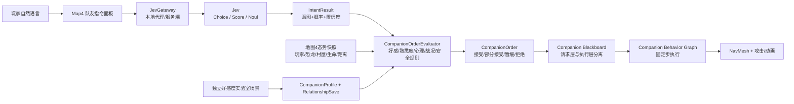

# 地图4二次元女性队友、Jev 指令与好感度实验室方案

状态：已实现首版；行为图、Jev 指令、关系实验室与地图4队友已接入，模型替换保留为可授权资源接入步骤。
目标场景：`Assets/LlamAcademy/Dinos/Scenes/FirstPersonDefenseBattlefield.unity`（地图4“星光守卫”）  
适用版本：Unity `6000.3.22f1`，项目当前使用 URP、Input System、Unity Behavior、AI Navigation 和本地 ML-Agents。

## 1. 结论先行

建议先实现“规则行为图 + 本地指令评估”，把强化学习列为第二阶段的可选优化。地图4已有可控的二次元女性角色、第三人称相机、法杖攻击、技能、NavMesh、HUD 和村庄防守流程；`com.unity.behavior` 1.0.13 也已有巡逻、移动、攻击节点。首版没有必要用强化学习解决跟随、守点、攻击和撤退这些可解释行为。

Jev 适合放在“自然语言 → 有限意图”的决策边界，而不是让它直接驱动 Transform、NavMeshAgent 或造成伤害。用户输入“待在我身边”“你可以离开自主防卫”后，Jev 只返回预先定义的意图、优先级建议和置信度；本地规则再结合好感度、熟悉度、心理属性、当前战况和安全边界，决定接受、部分接受、暂缓或拒绝。这样既保留角色性格，又不会让网络模型绕过游戏规则。

角色名为“**溯光**”。她是远程法杖守卫，默认保护玩家和村庄之间的安全线；好感度高时更愿意贴近玩家、主动救援，熟悉度低时会要求更明确的命令，危险过高时仍会优先自保。

角色介绍：“星空”是她的来处，辽阔无垠，不分贵贱；“地外星系”是她所在的远方，于这个世界之外，以另一种目光理解生命；“望向内心”是她认识一个人的方式，看见宇宙之中，那片不为人知的宇宙；“夜晚”是她到来的时刻，唯有星空可见的夜里，她才会循着微光而至。

技能介绍：法杖自动攻击（基础伤害18、射程8米、间隔0.85秒）；协同守护（跟随、守点、集合）；自主防卫（获得授权后结合关系与战况巡逻村庄）。这些是队友当前已实现的能力。

## 2. 已确认的工程基线与不可破坏的边界

| 项目 | 当前事实 | 对本功能的影响 |
| --- | --- | --- |
| 地图4入口 | `GameMapId.FirstPersonDefenseBattlefield`，场景名 `FirstPersonDefenseBattlefield` | 新队友只在该地图启用，实验室场景单独路由 |
| 现有女性角色 | `Assets/ThirdParty/VRoid/SendagayaShino`，Humanoid 动画、法杖与第三人称跟随相机已存在 | 可复用导入/动画流程；队友建议使用独立实例、材质与颜色，不覆盖玩家角色 |
| 行为图 | `Dino Graph.asset`、`Enemy AI Graph.asset`，自定义导航/攻击节点在 `Assets/LlamAcademy/Dinos/Behavior` | 新建 `Companion Graph.asset` 和队友专用黑板；复用底层动作节点 |
| 固定步 | `Unit` 会配置 `DinoFixedBehaviorGraphDriver`，在固定步手动调用 `BehaviorGraphAgent.Update` | 队友决策写入下一固定步生效，避免 `Update` 与行为图重复 tick |
| 防守结构 | `DefensePlacementController` 快照固定 3墙+5弓+3法；正式推理观测固定 11 个守卫槽位 | 队友不占布防库存、不调用 `RegisterPlacedGuard`、不写入旧 `guards[11,7]` 观测协议 |
| 胜负 | `RoundManager` 仍以恐龙进入目标半径、50模拟秒等规则判定村庄结果 | 队友倒地不直接结束战斗；队友只改变防守能力和战况 |
| 时间 | 地图4默认 `Time.timeScale = 0.5` | 战斗冷却/命令持续时间用模拟时钟；网络超时和 UI 输入锁用实时钟 |
| 输入 | 玩家类直接处理 WASD、Shift、Space、鼠标、Enter、Esc、Q/E/R | 聊天窗口获得焦点时必须统一屏蔽移动、施法和视角捕获 |
| 现有 ML-Agents | 目前用于恐龙部署/推理，不是单体队友运动控制 | 不复用旧模型控制队友；后续训练要有独立协议和训练场景 |

## 3. 总体架构



运行时要分成四层：

1. **感知层**：读取玩家、活跃恐龙、村屋威胁、队友生命、NavMesh 可达性和当前战斗阶段；只更新 `Threats`，不直接覆盖玩家命令。
2. **指令层**：Jev 负责有限意图识别；`CompanionOrderEvaluator` 用确定性规则决定实际许可。
3. **行为图层**：根据实际许可、威胁优先级和距离约束执行跟随、守点、攻击、撤退、重聚。
4. **表现层**：动画、头顶状态、语音/字幕、拒绝或部分接受的原因；表现层不能反向修改战斗结果。

异步 Jev 回包不能阻塞行为图。回包进入线程安全队列，在主线程的固定步边界校验后再写入黑板；校验 `sessionId`、`requestId`、`stateRevision`、`issuedAt` 和 `expiresAt`，过期或跨场景回包直接丢弃。

## 4. 队友角色与战斗职责

### 4.1 角色定位

- **职业**：远程奥术守卫；中等生命、低近战能力、稳定远程攻击。
- **默认人格**：偏内倾、直觉和情感判断，面对陌生命令会先观察，面对明确的村庄危机会迅速行动。
- **默认职责**：保护玩家周边、拦截接近村屋的恐龙、在玩家离开后临时自主防守。
- **安全边界**：不可穿过不可达区域；不可攻击玩家、友方队友或村屋；低生命时撤退/求援；战斗结束后停止图并回到待机。
- **可见反馈**：状态标签（跟随/自主防卫/守点/撤退）、当前目标、信任提示、拒绝原因和 Jev 置信度（调试模式）。

### 4.2 新增运行时组件（命名建议）

| 组件 | 职责 | 依赖 |
| --- | --- | --- |
| `CompanionController` | 队友生命周期、关系快照、阶段 gating、对外 API | `IDamageable`、NavMesh、`DefenseBattleCoordinator` |
| `CompanionBehaviorGraphBinder` | 绑定 `BehaviorGraphAgent`、固定步更新、写入黑板 | Unity Behavior 1.0.13 |
| `CompanionThreatSensor` | 只收集活跃恐龙和村屋威胁，过滤玩家/友方 | `AttackRadius`、`RoundManager` |
| `CompanionOrderEvaluator` | 将语言意图变成本地可执行命令 | 纯 C#，可 EditMode 测试 |
| `CompanionJevAdapter` | 组装 typed request、发请求、校验回包 | `JevGateway` |
| `CompanionDialoguePanel` | UI Toolkit 输入、历史、状态和确认 | `FirstPersonDefenseHud` 输入焦点协作 |
| `CompanionSaveService` | 关系档案与实验室修改的版本化存储 | JSON/现有存档策略；实现前先确认项目存档约定 |

不要直接把队友当作现有 `Defender` 注册：`Defender.OnTargetEnter` 会把通用 `Command` 改成 `Attacking`，会破坏“待在我身边但只在近处自卫”；同时注册还会污染活跃守卫计数、死亡返肉、布防快照和旧训练观测。队友可独立实现 `IDamageable`，或复用可拆出的基础攻击服务，但必须保持单独的友方元数据和碰撞过滤。

## 5. Companion Behavior Graph 设计

### 5.1 黑板分层

**玩家请求层（可被语言改变）**

- `RequestedMode`: `FollowPlayer`、`AutonomousDefense`、`HoldPosition`、`ProtectPlayer`、`Regroup`
- `OrderId`、`OrderSource`、`OrderExpiresAt`、`OrderTextHash`
- `RequestedAnchor`、`RequestedFollowDistance`、`RequestedLeashRadius`

**执行许可层（只由本地规则写入）**

- `AcceptedMode`、`Acceptance`: `Accepted`、`Partial`、`Deferred`、`Rejected`
- `FollowDistance`、`LeashRadius`、`AllowedRisk`、`MaxPursuitSeconds`
- `DecisionReasonCode`、`DecisionConfidence`、`StateRevision`

**态势层（只由传感器/战斗上下文写入）**

- `Player`、`PlayerDistance`、`PlayerHealthRatio`
- `Threats`、`HighestThreat`、`VillageThreat`、`DefenseAnchor`
- `HealthRatio`、`NavMeshReady`、`RoundState`、`CombatTimeRemaining`

### 5.2 顶层优先级

```text
战斗结束/禁用
  > 死亡与倒地恢复
  > 生命危险、无法到达或被卡住
  > 玩家正在被高威胁目标攻击
  > 村屋进入紧急威胁半径
  > 当前玩家命令（跟随/自主防卫/守点）
  > 低优先级巡逻、待机、表现
```

### 5.3 子图

1. **FollowPlayer**：保持 `FollowDistance`；超出 `LeashRadius` 才追赶；在跟随点附近攻击可达目标，不因普通小目标远离玩家。
2. **ProtectPlayer**：玩家受高威胁攻击时短暂脱离，先攻击威胁源，再回到跟随点；超出 `MaxPursuitSeconds` 自动收回。
3. **AutonomousDefense**：根据村屋威胁、敌人距离和可达性选择防区；优先村屋安全，其次回到玩家可见范围。
4. **HoldPosition**：到达指定锚点后保持，攻击范围内威胁；目标死亡、锚点失效或命令过期时回到默认防守。
5. **Combat**：选择目标、视线/射程检查、导航、攻击、冷却、目标死亡后的重选；目标过滤只允许活跃 `Dino`。
6. **Recover/Rejoin**：低生命撤退、无 NavMesh 时等待、路径失败时换候选锚点、脱离战场后重新集合。

行为图只决定“如何执行已批准的命令”。它不读取自然语言，也不直接判断好感度，避免图资产中出现难以测试的隐式关系规则。

## 6. 自然语言与 Jev 的接入

### 6.1 适合 Jev 的问题形状

Jev 是 TypeSafe AI 的 hosted System One decision model：输入状态和预定义 typed questions，返回 Choice、Score 或 Noul 结果与概率/置信度；它不负责生成对白，也不应直接执行副作用。官方文档明确建议把复杂判断拆成多个独立问题，并由代码组合结果。

建议第一版一次请求同时询问：

```json
{
  "model": "jev-latest",
  "state": {
    "utterance": "待在我身边，村口交给你自己判断",
    "relationship": {"affinity": 72, "familiarity": 48, "trust": 61},
    "personality": {"extraversion": 0.35, "sensation": 0.42, "intuition": 0.78, "thinking": 0.38, "feeling": 0.76},
    "battle": {"roundState": "Running", "playerThreatened": false, "villageThreat": 0.32, "selfHealth": 0.91}
  },
  "questions": {
    "intent": {
      "type": "choice",
      "instructions": "用户希望队友执行哪一种受限战术意图？",
      "criteria": {
        "follow_player": "保持在玩家附近并在附近自卫",
        "autonomous_defense": "离开玩家，在村庄防区自主防卫",
        "hold_position": "前往并守住指定地点",
        "protect_player": "优先保护玩家并拦截攻击者",
        "regroup": "停止远离并回到玩家或集合点",
        "clarify": "无法从这句话可靠判断意图"
      }
    },
    "urgency": {
      "type": "score",
      "instructions": "这条命令的紧迫程度如何？",
      "criteria": ["闲聊或低优先级", "普通战术命令", "立即处理的危险命令"]
    },
    "explicit_autonomy": {
      "type": "noul",
      "instructions": "用户是否明确允许队友自主判断和离开玩家身边？"
    }
  }
}
```

实际请求使用项目选定的 TypeSafe 官方 API 端点；端点、SDK 和模型版本以接入时的官方文档为准，不把 API key 放进 Unity 客户端、Asset 或公开仓库。推荐结构是：

```text
Unity → 轻量 JevGateway（本机开发代理/发行版服务端）→ TypeSafe API
```

Gateway 负责密钥、限流、重试、请求日志脱敏和模型版本固定。离线或超时时，使用本地关键词/模板意图解析和上一条已批准命令，游戏仍可完整进行。

### 6.2 置信度与本地门槛

推荐初始门槛（需通过日志和玩家测试调参）：

- `confidence >= 0.80`：低风险意图可自动接受；
- `0.55–0.79`：若关系不足或命令会远离玩家，部分接受或要求 UI 确认；
- `< 0.55`：不执行远离/高风险命令，进入“请说得更明确”或本地默认防守。

Jev 的概率只表示模型对候选项的判断，不是好感度，也不是执行授权。`CompanionOrderEvaluator` 必须再检查：战斗阶段、目标点可达性、队友生命、玩家是否被攻击、命令是否过期、关系阈值以及玩家是否拥有该动作权限。

### 6.3 两个核心示例

**“待在我身边”**

- 高/中好感：接受 `FollowPlayer`，缩小 `FollowDistance`，保留近身自卫半径。
- 低熟悉度：接受但要求明确锚点；不读取含糊的“这里”作为世界坐标。
- 低信任或队友重伤：部分接受，变为“在玩家附近安全点守卫”，不贴身跟随。

**“可以离开自主防卫”**

- 高熟悉度且村屋有威胁：接受 `AutonomousDefense`，选择最近可达防区并设置回防条件。
- 好感度一般、威胁低：部分接受，先移动到玩家视线边缘或短时守点。
- 低信任、低置信度或队友生命危险：暂缓/拒绝，并显示原因；仍会在紧急救援规则下短暂自主保护村庄。

模型不能生成任意命令名、坐标、伤害数值或代码；所有可执行值只能来自本地枚举、范围和候选锚点。

## 7. 好感度、熟悉度与 Jung 心理属性

### 7.1 数据分层

建议建立 `CompanionProfile`（角色相对稳定）与 `RelationshipState`（玩家关系随游戏变化）两类 ScriptableObject/序列化数据。实验室只修改数据，地图4在开局复制一个只读运行时快照。

**稳定心理属性（0–1，设计参数，不作为临床测评）**

| 属性 | Jung 参考 | 影响 |
| --- | --- | --- |
| `Extraversion` | 外倾 ↔ 内倾 | 更愿意主动靠近、主动报备或独立行动 |
| `Sensation` | 感觉 | 更重视眼前距离、可见目标和具体守点 |
| `Intuition` | 直觉 | 更愿意根据趋势、村庄整体风险提前换防 |
| `Thinking` | 思维 | 更看重规则、路径、收益和命令清晰度 |
| `Feeling` | 情感 | 更看重关系、承诺、玩家状态和村民安全 |
| `RiskTolerance` | 游戏化扩展 | 决定允许的追击半径与低生命冒险程度 |
| `NeedForAutonomy` | 游戏化扩展 | 决定对“你自己判断”的正向响应幅度 |

Jung 原始框架重点是外倾/内倾和思维、情感、感觉、直觉四种功能；这里将它们作为游戏中的连续权重，而不是给玩家贴固定人格诊断。需要显示四种功能时，用雷达图和行为解释，不使用医学或心理诊断措辞。

**关系属性（0–100）**

- `Affinity`：对玩家的当前好感，受尊重、救援、共同胜利、粗暴拒绝等事件影响。
- `Familiarity`：对玩家习惯、命令词和战术的熟悉程度，随共同战斗和重复指令增长。
- `Trust`：相信玩家会兑现承诺、不会把她置于无意义危险；比好感更直接影响高风险命令。
- `Respect`：对玩家战斗能力和判断的认可；影响是否愿意接受简短命令。
- `Stress`：本局临时压力，受受伤、村屋危机、连续失败影响；结算后按规则衰减。

### 7.2 命令许可公式（可解释、可调参）

```text
relationshipScore =
  0.35 * affinity01 +
  0.25 * familiarity01 +
  0.25 * trust01 +
  0.15 * respect01

autonomyScore =
  0.45 * relationshipScore +
  0.25 * needForAutonomy +
  0.15 * intuition +
  0.15 * (1 - stress01)

executionScore =
  0.50 * intentConfidence +
  0.20 * autonomyScore +
  0.15 * tacticalUrgency +
  0.15 * safetyScore
```

最终行为不是简单比较单一分数：

- `executionScore >= 0.75` 且安全检查通过：接受；
- `0.50–0.74`：缩短时限、缩小追击半径或先到安全锚点，标为部分接受；
- `< 0.50`：暂缓/拒绝，保留本地默认防守；
- 玩家受攻击、村屋紧急或队友即将倒地：高优先级安全规则覆盖语言命令。

每次决定记录 `reasonCode`，例如 `LowFamiliarity`、`PlayerUnderThreat`、`UnsafeDestination`、`LowConfidence`、`AutonomyGranted`，用于 UI、调试和回放。

## 8. 独立好感度交互界面场景

### 8.1 场景与入口

新增独立场景建议命名 `CompanionLab.unity`，不加载 `RoundManager`、`DinoSpawner` 或地图4的战斗单例。地图选择或开发菜单进入该场景；返回地图选择时只提交版本化关系数据。

场景根节点建议：

```text
CompanionLab
├─ CompanionLabController
├─ CompanionProfileDatabase
├─ RelationshipSaveService
├─ UIDocument (UI Toolkit)
├─ PreviewCamera + Light
└─ PreviewCompanion (只读预览实例，不启动战斗行为图)
```

### 8.2 UI 布局

- 左栏：角色卡、立绘/模型预览、当前人格摘要、关系等级。
- 中栏：好感度、熟悉度、信任、尊重、压力的滑块/数值输入；“重置为默认”“保存快照”“载入快照”。
- 右栏：Jung 维度雷达图（外倾/内倾、感觉/直觉、思维/情感），风险容忍度和自主需求。
- 下栏：命令模拟器。输入“待在我身边”“去村口自己防守”等文本，显示模拟的意图、置信度、关系门槛、接受/部分接受/拒绝及原因；默认使用本地 Mock Jev，不在实验室误消耗线上额度。
- 调试折叠区：当前 `CompanionOrder`、黑板值、图节点、状态修订号、最近事件日志；发行版默认关闭。

所有直接调值必须标注“实验室调整”，与正常游戏事件分开。进入地图4时复制 `RelationshipState`，战斗内只写运行时副本；“应用到正式档案”是显式按钮，避免预览拖动实时改变战斗。

### 8.3 数据和存档规则

- 数据结构带 `schemaVersion`、`profileId`、`lastModifiedUtc`、`source`（事件/实验室/测试）。
- 场景重载只重建运行时队友；关系档案是否保留由启动选项决定，推荐保留关系、重置本局压力和临时命令。
- Jev 回包只属于发起它的 `sessionId`；地图重试或返回实验室后全部失效。

## 9. 强化学习何时加入

首版不训练队友。行为图在下列情形仍有量化缺陷时，再建立独立训练环境：固定种子下出现明显卡位、多个村屋威胁的防区选择长期劣于基线、撤退/重聚频繁失败，且规则调参无法稳定解决。

后续训练应：

1. 新建 `CompanionTraining` 场景和独立 `CompanionObservationLayout`，不改变 `dino_attack_structured_set_v2` 的维度、守卫槽位或现有模型哈希。
2. 观察玩家距离、村屋威胁、敌人相对位置、生命、可达性、当前命令和关系权重；动作只输出离散战术意图/锚点偏好，不直接输出任意速度或伤害。
3. 奖励包含村屋存活、玩家救援、命令遵守、低伤亡、回到安全锚点、避免友伤和避免无效追击；对拒绝危险命令给出正向奖励。
4. 训练模型只做“候选排序”，最终仍经过 `CompanionOrderEvaluator` 安全门和行为图执行。
5. 在 100+ 固定种子、断网、低置信度、队友倒地和多恐龙压力下与纯行为图基线比较；没有稳定提升就不接入发行版。

## 10. 分阶段实施与交付物

### Phase 0：合同与可行性（0.5–1天）

- 固定 `CompanionMode`、`CompanionIntent`、关系字段、黑板字段、回包 schema 和 `sessionId/stateRevision` 规则。
- 确认 TypeSafe API 账号、模型版本、数据保留策略、地区/网络可用性和 Gateway 部署方式。
- 确认队友外观许可；现有 Shino 为独立 CC0 来源，但队友实例仍应有可追踪的来源记录。

### Phase 1：纯行为图队友（2–4天）

- 新建队友预制体、`Companion Graph.asset`、威胁过滤、跟随/守点/自主防卫/撤退子图。
- 接入地图4开战、结束、重试和 NavMesh readiness；不触碰旧布防库存和恐龙推理协议。
- 完成离线命令按钮，验证队友能在没有 Jev 时独立保卫村庄。

### Phase 2：关系数据与实验室（2–3天）

- 新建 `CompanionLab.unity`、Profile/Relationship 数据资产、UI Toolkit 面板、版本化保存和模拟器。
- 用本地规则模拟“接受/部分接受/拒绝”，先不接网络，便于设计调参与测试。

### Phase 3：Jev Gateway 与自然语言（2–4天）

- 增加 Gateway、超时/重试/限流/脱敏、Mock Provider 和真实 Provider。
- 接入 Choice/Score/Noul 结果；加入置信度门槛、主线程提交、回包过期和断网回退。
- 在 UI 显示队友的简短本地化反馈；对白可由固定模板或另一个文本系统生成，Jev 本身只做决策。

### Phase 4：平衡与可选 RL（持续）

- 采集匿名化的意图、置信度、关系值和结果事件；检查玩家是否理解拒绝原因。
- 只有行为图基线有稳定、可复现的战术缺陷时才启动独立训练协议。

## 11. 测试与验收标准

### EditMode

- 意图枚举、JSON schema、概率和置信度边界；未知选项必须安全失败。
- 好感/熟悉度/信任/心理属性到接受、部分接受、暂缓、拒绝的确定性映射。
- 命令过期、跨 `sessionId`、旧 `stateRevision` 的回包不会写入黑板。
- 实验室改值、重置、保存/载入、schema 升级和地图4快照复制。

### PlayMode

- 地图4仍只生成一个玩家控制角色和一个队友；旧布防快照仍要求 11 件物件。
- 队友不出现在旧 `guards[11,7]` 观测中，不增加 `AliveDefenders` 或死亡返肉奖励。
- 跟随命令在近距离攻击时不被 `Attacking` 永久覆盖；追击半径和超时能回到玩家。
- 自主防卫能选择可达防区；不可达目标触发回退而不是卡死。
- 聊天输入获得焦点时 WASD、鼠标、Enter、Esc、Q/E/R 不会误触发；关闭聊天后控制恢复。
- 队友倒地、玩家倒地、村屋受损和恐龙进入目标半径都遵循现有胜负规则。
- `Time.timeScale = 0.5` 下，战斗冷却按模拟时间运行，网络超时仍按实时钟运行。
- 切换场景、同布局重试、返回实验室后，旧队友图、命令和 Jev 回包不残留。

### 固定种子回归

至少覆盖：无威胁、单目标接近、多个村屋同时受威胁、玩家远离、低生命、NavMesh 暂不可用、断网、低 Jev 置信度、恶意/无关文本、Jev 超时和跨场景迟到回包。验收以“村庄规则不回归、队友不友伤、命令可解释、行为可复现”为准。

## 12. 风险与待确认事项

1. **Jev 网络与成本**：公网调用有延迟、限流和费用；必须保留 Mock/离线回退，不能让核心战斗依赖网络。
2. **自然语言歧义**：中文方言、简称、战斗噪声会降低置信度；`clarify` 是合法结果，低置信度不应猜测高风险动作。
3. **玩家期望**：拒绝命令需要短而明确的原因，例如“我现在血量太低，先守在村门内侧”，避免只显示“AI拒绝”。
4. **资源许可**：玩家现有 Shino 与动作来源已有 `SOURCE.md`；队友若复制模型、动作或材质，必须记录各自许可，不能假设继承。
5. **输入冲突**：地图4现有玩家逻辑直接读键鼠，聊天面板必须引入统一的 `InputCaptureService` 或等价门控，而非只在 UI 上显示 TextField。
6. **旧程序集边界**：若新增 asmdef，不能让 Core 反向引用预定义 `Assembly-CSharp`；建议先放在现有运行时层，待接口稳定再拆程序集。
7. **行为图版本**：Unity Behavior 资产是序列化资源，不能用文本替换场景 YAML 代替 Editor 接线；应使用 Unity Editor builder/手工接线并运行场景测试。
8. **心理属性表达**：Jung 维度在本方案中是游戏化人格参数，不是心理诊断。UI 和文案要避免把数值解释成现实人格结论。

## 13. 建议的第一批文件清单（仅规划）

```text
Assets/LlamAcademy/Dinos/Companion/
├─ CompanionController.cs
├─ CompanionOrderEvaluator.cs
├─ CompanionThreatSensor.cs
├─ CompanionBehaviorGraphBinder.cs
├─ CompanionJevAdapter.cs
├─ CompanionProfile.cs
├─ RelationshipState.cs
├─ Companion Graph.asset
├─ Companion Blackboard.asset
└─ Prefabs/Companion.prefab

Assets/LlamAcademy/Dinos/CompanionLab/
├─ CompanionLabController.cs
├─ CompanionDialoguePanel.cs
├─ CompanionSaveService.cs
└─ CompanionLab.unity

Assets/Tests/Editor/
└─ CompanionOrderEvaluatorTests.cs

Assets/Tests/PlayMode/
└─ CompanionMap4PlayModeTests.cs
```

开始实现前需要产品层确认的只有三项：角色最终姓名/外观与武器、关系档案是否跨新局保留、Jev Gateway 采用本机开发代理还是线上服务端。其余结构可按本文默认值推进。

## 参考资料

- [TypeSafe AI 文档：Introduction](https://docs.typesafe.ai/introduction)：Jev 输入状态和 typed questions，返回代码可直接使用的结构化结果。
- [TypeSafe AI 文档：Quick start](https://docs.typesafe.ai/introduction/quickstart)：Choice、Score、Noul 请求/响应形状和 API 调用方式。
- [TypeSafe AI 文档：Choice](https://docs.typesafe.ai/primitives/choice)：固定候选、概率与置信度的设计方式。
- [TypeSafe AI 文档：Confidence](https://docs.typesafe.ai/confidence)：按风险设置置信度门槛的建议。
- [Unity Behavior 文档](https://docs.unity.com/en-us/engine/6000.3/manual/packages-list/packages-all/pack-safe/com-unity-behavior)：Unity Behavior 包的版本入口。
- [Jung 类型学概览（Society of Analytical Psychology）](https://www.thesap.org.uk/articles-on-jungian-psychology-2/about-analysis-and-therapy/typology/)：外倾/内倾以及思维、情感、感觉、直觉四种功能的背景说明。
