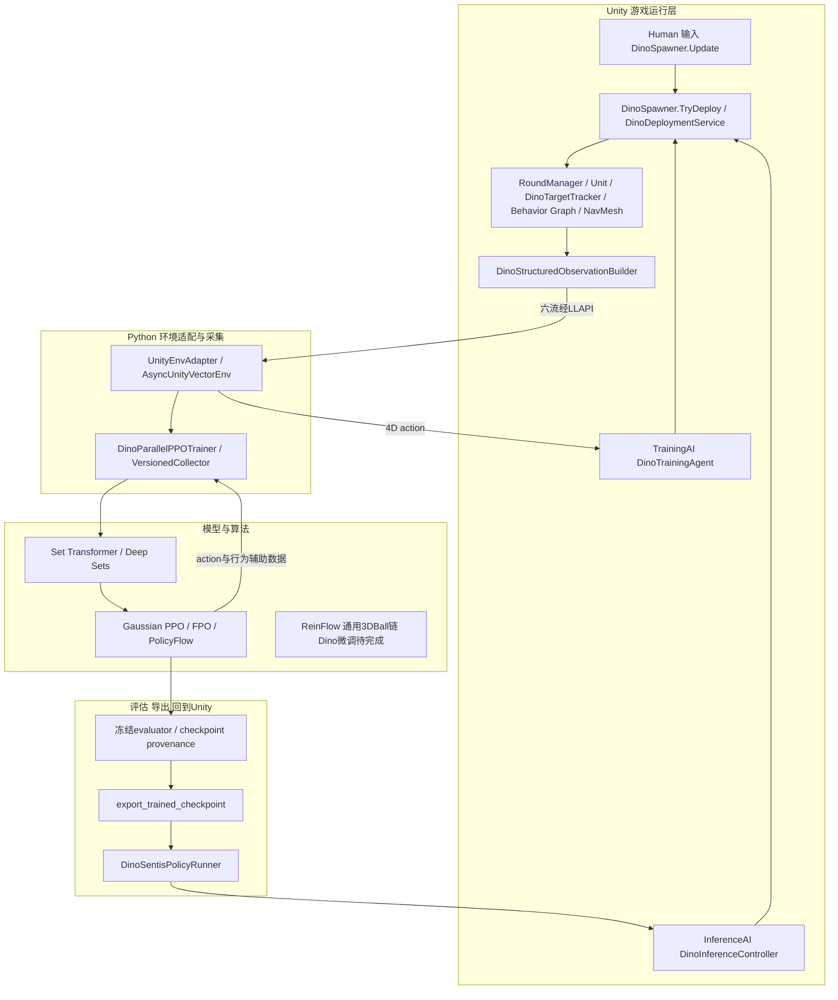

# Unity 战斗与 AI 项目：秋招学习讲义

> 阅读目标：能沿真实代码解释一次部署、一次攻击、一次训练更新和一次重开；能说明为什么修、怎样验证、哪些结论还不能下。面试表达应建立在这些能力之上。
>
> 本文为 **2026-09-05 文档调查版**。运行状态截止 **15:20（Asia/Shanghai）** 的一次性磁盘读取；不是实时监控。源码为当日本机正式检出及其既有未提交修改。本文没有启动、恢复、停止训练，没有运行 Python/Unity 测试、构建或修改生产代码。

<a id="guide"></a>
## 1. 阅读指南、证据规则与完成边界

### 1.1 怎么使用这份讲义

第一遍先读游戏和两条调用链，回答“玩家在做什么、谁拥有状态”。第二遍读案例 1–5 和案例 7，把 Unity 时序、事件、导航和 UI 串起来。第三遍读数据与算法，最后练习口述。遇到公式先看输入、输出和 shape，不必先背推导。

导航：[游戏与岗位](#overview) · [架构与调用链](#architecture) · [改动总表](#changes) · [战斗与生命周期](#combat) · [时基与帧同步](#timing) · [训练与算法](#rl) · [工程验证](#engineering) · [面试介绍](#pitch) · [30 道面试题](#questions) · [7 天学习](#week) · [术语与索引](#index)。

完整案例导航：[1 部署与结算](#case1) · [2 出生与目标](#case2) · [3 重复命中与死亡](#case3) · [4 导航](#case4) · [5 等待与时钟](#case5) · [6 rollout 数据](#case6) · [7 UI 与推理](#case7) · [8 成功数据与 BC](#case8) · [9 checkpoint 与选模](#case9) · [10 builder 与集成验证](#case10)。每案都有基础、源码、验证、面试追问和两道练习；练习仅是学习任务，未在项目执行。

### 1.2 五种证据标签

| 标签 | 本文含义 | 不能推出什么 |
|---|---|---|
| **已有实现且有验证证据** | 当前源码存在，另有带日期、范围的历史测试/运行记录 | 本次 dirty 检出全量通过、所有设备通过 |
| **已有实现但验证不足** | 能定位实现，缺少对应运行门，或存在已知失败 | 功能已最终验收 |
| **历史方案已取代** | 旧计划/diff 能证明曾存在，后续决策改变 | 仍是当前合同 |
| **仍未完成** | 最新计划保留出口，或当前产物不足 | 可用局部 smoke 提前勾选 |
| **面试延伸知识** | 为承接岗位而讲的基础、设计练习 | 项目已经实现或本人已有工作经历 |

源码链接指向当前文件和当前核实行号；历史说明指向报告、旧计划及 Git 对象。不能用旧报告的行号定位今天的源码。**当前代码、历史验证、个人贡献是三件不同的事。** 本文用“项目实现了”作为默认口径；“我独立完成”须由你自己确认。

事实优先级为：[主计划][r-plan] 的最新决策/追加证据 → 本轮实际源码及 run 配置/产物 → [桌面旧计划][r-oldplan] 对历史的解释。旧计划分段查阅了基础算法、地图/镜头、单局改造、结构化协议、战斗调查等记录，未修改旧文件。根 AGENTS 与目录检查未发现本次目标目录另有适用 AGENTS。Unity 调查采用 Workbench 只读审查流程。

### 1.3 本轮确认的版本与冲突

根 Git HEAD 为 `209725f`；Unity 正式 HEAD 为 `7a0c200`。UI 集成 merge 为 `f127f32`，UI/地图三来源 `9c552ec` 已进入正式历史，不能再笼统称“仅在独立 worktree”。`ui-integration` 与正式检出同 HEAD；`ui-enhancement` 仍停在自己的快照。当前正式目录还存在 FPO 独立资源/推理路由、默认选图入口等 dirty/untracked 改动。因此：已合入的 UI，与本机已存在但尚未提交的 FPO 接线，要分别说明。[集成报告][r-integration]

主计划开头 13:03 复核覆盖了更早“PPO 未启动、FPO 仍运行、PolicyFlow 未实现”等陈旧看板。其后又有恢复首 update 通过记录；本轮 15:20 读取到恢复 run 的最新完整 CSV 行是 **1,704,860 environment steps、update 104、行为 policy version 103**，尚无 `summary.json`。这只证明持久化进度，不证明现在进程仍活着，也不证明整个运行完成。[恢复配置][r-pf-config] [恢复更新记录][r-pf-updates]

主计划中的阶段状态仍是 **0–7 已完成、8 进行中、9–10 未开始**。本文不改变这些状态。阶段 8 包括未闭环的确定性、中断、构建指纹、统一比较和人工验收，不应按“完成阶段个数”计算项目完成百分比。

| 当前项目事实 | 标签与边界 |
|---|---|
| 玩家持续部署、规则战斗、两张进攻地图、六流 v2、PPO/FPO 推理链 | 已有实现且有历史定向证据；不代表当前完整游戏回归全绿 |
| 地图三布防、同场景 AI 进攻、专用结算 | 核心已合入且有历史 Player/测试证据；矩形人工冻结、异常/重试矩阵未全部完成 |
| PPO FixedClockV5 seed0、FPO warm-start 长跑 | final/summary 已存在；FPO 长期策略曾崩塌，运行 PASS 不等于策略质量 PASS |
| PolicyFlow Dino | 数据、BC、结构化训练器、smoke 和恢复运行已有；正式训练及最终冻结比较未完成 |
| ReinFlow Dino | 仍未完成在线微调；3DBall 成功不可迁移为 Dino 完成 |
| 多人帧同步、LLM NPC、C++ 底层系统、action chunk | 没有本轮支持其完成的证据；只能作为延伸/后续学习 |

历史测试底线：2026-09-05 根目录非集成 Python 审计 **372 passed、1 failed、3 deselected**，唯一失败是测试要求 20 env 而实际 YAML 为 16 env；另有从错误 cwd 运行导致 BC 相对路径失败的记录。Unity 集成历史 EditMode **25/25**、PlayMode **46/59**，13 项失败与正式基线同名，不能写“Unity 全量通过”。[完成审计][r-audit]

<a id="overview"></a>
## 2. 先认识游戏，再认识你的改造

### 2.1 一局游戏到底玩什么

Dino Attack 的原题材是恐龙夺回被人类拿走的蛋，属于反向塔防：玩家投放进攻单位，守卫阻止恐龙进入目标范围。你不逐个操纵恐龙走位。玩家在地图选择页选图，进入 Setup 后选择恐龙、在五个可部署区域内放置；开始后仍能继续部署。资源用完就等待战斗反馈，击杀/拆毁产生返肉，再选择位置和兵种。

当前进攻局由 **本局已登记且存活的 Dino 进入唯一目标范围**触发胜利，并不要求清空所有守卫或拆掉全部房屋。Running 达到 50 游戏秒是自然失败；资源耗尽条件为无存活恐龙且肉 `<25`。代码的资源耗尽检测入口在 `OnDinoDeath`，不是任何资源变更都自动触发一次全局轮询；阅读时应区分规则谓词与调用时机。[胜利检查][s-victory] [资源耗尽][s-exhaustion]

Ending 冻结胜负，随后进入 Ended 显示结果。玩家可同布局重试、生成新布局、让 AI 在同布局进攻或回地图选择。地图三切换角色：你放防御，AI 投恐龙；恐龙到目标代表防守玩家失败，超时/AI 资源耗尽代表防守成功。主动退出有独立的防守方认输路由，不能直接复用进攻方胜负文字。[地图三协调器][s-defense]

### 2.2 哪些来自上游，哪些是项目工作

| 来源 | 能确认的内容 | 合适的归属说法 |
|---|---|---|
| LlamAcademy 原游戏 | 反向塔防、Dino/Defender/Wall、Behavior Graph、NavMesh、攻击配置、UI 与原回合设计 | “在开源 Dino Attack 基础上改造” |
| Unity 与第三方包 | 引擎生命周期、物理、AI Navigation、Behavior、Cinemachine、Input System、推理执行库 | “集成并按项目需求使用”，不是自研这些底层系统 |
| 第三方美术 | polyperfect 模型及其他导入/衍生场景资产 | “整理、导入、适配、组合美术”，不是原创建模；分享前需遵守仓库资产说明 |
| 项目新增/改造 | 持续部署共享规则、地图几何、单局重启、目标生命周期修复、固定步 gameplay、结构化训练/评估/导出、地图三与 UI | 可作为工程贡献候选，个人独立程度另行确认 |
| 官方算法 | FPO、ReinFlow、PolicyFlow 的数学路线和参考实现 | “核对固定版本并移植到 Unity 外部训练框架”，不是原创算法 |

[原游戏 README][r-upstream] 明确介绍来源及代码/美术的不同许可说明。本文不对第三方资产作新的授权判断，也没有执行公开发布。原 README 的旧场景入口和旧多回合描述不是当前玩家流程的事实来源。

### 2.3 岗位要求 → 项目证据 → 学习目标

| 岗位要求 | 项目证据 | 必须理解 | 当前不足 | 建议面试表述 |
|---|---|---|---|---|
| Unity/C# 工程 | Unit、Spawner、RoundManager、asmdef | 生命周期、事件订阅、接口、状态归属 | 移动设备验证不足 | “能从部署入口追到死亡和结算” |
| 战斗系统 | 共享目标、延迟命中、资源账本 | 一次效果、一次死亡、一次奖励不是同一层 | 完整重载和三恐龙人工门未闭环 | “围绕可复现案例修复战斗生命周期” |
| 行为树/FSM | Dino Graph + Tracker + GameState | 高层编排与状态所有权 | 不是完整自研通用 BT/FSM 框架 | “保留图编排，C# 维护每只恐龙目标” |
| 高实时性/帧同步 | 回包延迟实验、固定 tick、capture clock | 墙钟/游戏时间/决策频率 | 无网络 lockstep、严格确定性未过 | “做过时基一致性排错，尚未做多人帧同步” |
| RTS/MOBA 相关 | 单位部署、类别优先级、NavMesh、RTS 镜头 | 资源与目标取舍、输入隔离 | 规模远小于商业 MOBA/RTS | “有 RTS 风格单局 Demo 工程经验” |
| 强化学习/决策模型 | LLAPI、v2、PPO/Flow、ONNX | transition、GAE、策略版本、冻结评估 | Dino 四算法公平比较未完成 | “实现训练闭环并保留失败证据” |
| AI 代码 Agent | 计划约束、RED/GREEN、审查修正记录 | 如何验收生成结果、识别错误假设 | 具体使用工具与个人贡献待确认 | “项目有 AI 辅助工作记录，能解释验证流程” |
| C++ 基础 | 没有本轮确认的项目侧底层 C++ 实现 | 所有权、RAII、内存布局、虚函数 | 待学习 | “C# 为主，正在用小练习补 C++ 原理” |
| 游戏内 LLM | 没有 LLM NPC/实时决策完成证据 | 延迟、异步、结构化输出、规则兜底 | 待学习 | “代码 Agent 与游戏内 LLM 分开理解” |
| 跨角色协作 | 规格、核心接口、测试、worktree 合并 | 把策划需求写成输入/输出/验收 | 个人项目不能包装真实服务器团队经历 | “能用规格和 Demo 演示沟通方案” |

<a id="architecture"></a>
## 3. 架构与两条真实运行链



图中的训练器名字有历史包袱：`DinoParallelPPOTrainer` 提供并行调度骨架，FPO/PolicyFlow 经各自 decider、batch/updater 接口复用它，并非把算法全部改成 PPO。ReinFlow 的通用实现已在 3DBall 验证，不能把图中的未来连接想象成已完成 Dino 训练。

### 3.1 从部署请求到结算

真实 Human 入口是 [DinoSpawner.Update][s-spawner-update] 的射线与输入，调用 [TryDeploy][s-deploy]；AI 两种入口则是 [OnActionReceived][s-agent-action] 和 [TryProcessDecision][s-infer]。随后共同进入：

```text
DinoSpawner.TryDeploy
 → DinoDeploymentService.Evaluate（场景探测）
 → DinoDeploymentRules.Evaluate（纯规则）
 → SpawnAuthorizedDino（扣肉、Instantiate、发布 OnSpawnDino）
 → RoundManager.OnSpawnDino（登记 ActiveDinos）
 → Unit.Start / Dino.OnTargetEnter / DinoTargetTracker.Add
 → Dino.SyncTargetBlackboard
 → DinoFixedBehaviorGraphDriver.FixedUpdate → BehaviorGraphAgent.Update
 → SortAttackablesAction / MoveToClosestAttackableOnXzPlaneAction
 → AttackClosestObjectAction.OnUpdate → TryApplyEffect
 → AttackTypeSO.ApplyEffect → Unit.TakeDamage → TryBeginDeath
 → OnDeath → controller/round/奖励账本/其他 Dino 的 tracker
```

结局可以由 `[目标 AttackRadius] → RoundManager.HandleDinoEnterEggRadius`、`RoundManager.FixedUpdate` 超时或 `OnDinoDeath` 资源耗尽进入 `BeginEndingWithReason → BeginEnding`。**状态 setter 发布 Ending 事件后**，`DinoTrainingAgent.OnGameStateChange → ConcludeEpisode` 冻结训练奖励；自然结束调用 ML-Agents `EndEpisode`，异常主动中断走 `EpisodeInterrupted`。游戏表现 `FinishSession → Ended` 后，Human/Inference 的 `GameResultCollector.TryCaptureFromScene → TryFreeze` 生成结果。[回合结束][s-ending] [训练终结][s-conclude] [结果收集][s-result]

这里的箭头包含同步调用、事件订阅和后续 fixed tick，不代表一整个调用栈同帧一次执行完毕。胜利后清场不应再次给出失败或重复奖励，原因见案例 1、3。

### 3.2 从 observation 到更新，再部署

```text
DinoStructuredObservationBuilder.GetFrameForAcademyStep / BuildFrame
 → DinoStructuredObservationSensor.Write
 → ML-Agents RemotePolicy / RpcCommunicator
 → UnityEnvAdapter._accept_steps → _merge_steps
 → DinoParallelPPOTrainer._collect_and_update
 → DinoBatchedPolicyDecider / 对应Flow decider（按环境拼批再拆回）
 → policy.act（actions、value、log-prob或算法专用auxiliary）
 → AsyncUnityVectorEnv.submit_actions → UnityEnvAdapter.step
 → Unity产生下一观测/奖励/终止
 → VersionedCollector.record → seal_and_bootstrap → build_batch
 → compute_gae → 对应 PPOUpdater / FPOUpdater / PolicyFlowUpdater.update
 → 版本边界 checkpoint → 冻结 evaluator
 → export_trained_checkpoint → DinoSentisPolicyRunner.TryRun
 → DinoInferenceController.TryProcessDecision → 同一个 TryDeploy
```

[Python adapter][s-adapter] [版本 collector][s-collector] [并行 trainer][s-trainer] [GAE][s-gae] [导出模块][s-export] 是这条链的阅读入口。模型不是直接接管每只恐龙的攻击动作，它输出全局部署决策；恐龙的规则战斗继续由 Unity 完成。

<a id="changes"></a>
## 4. 主要工作与改动总表

下面按“解决了什么问题”合并参数迭代。状态“有证据”均指对应历史范围，不是本次重新验证。

| 阶段/原始问题 | 改动与模块 | 技术动机 | 验证/来源 | 当前状态 | 岗位关联 | 主要模块/文件 |
|---|---|---|---|---|---|---|
| 0–1 无统一基线和事实来源 | release_23 PPO、独立环境、AGENTS/计划 | 防止版本与范围漂移 | [旧计划][r-oldplan]、[阶段3对比][r-p3] | 基础有证据 | 工程治理 | [主计划][r-plan] |
| 2 LLAPI 异步 Agent、terminal-only | adapter、EpisodeTracker、liveness、GAE | 不靠 batch 下标串轨迹 | [旧计划阶段2][r-old-p2]，3DBall 100k 历史运行 | 有证据；Dino 中断矩阵仍缺 | 数据可靠性 | [UnityEnvAdapter][s-adapter] |
| 3 自定义算法需可解释基线 | tanh Gaussian PPO、独立评估、dataset | 先排除环境/采集错误 | [PPO实施报告][r-p3-readme]；空 batch reshape 失败后修正 | 有证据 | RL/测试 | [TanhGaussianActor][s-gaussian] |
| 4 Flow 基础 | velocity、Euler、NFE benchmark | 可测试采样与成本计数 | [阶段4验证][r-p4] | 有证据 | 数值工程 | [EulerFlowSampler][s-flow] |
| 5 FPO 移植 | CFM 差值 ratio、signed advantage、MC 快照 | 保留官方更新语义 | [阶段5][r-p5]；CUDA RNG 恢复失败记录 | 3DBall 完成 | 算法移植 | [algorithms/fpo.py][s-fpo] |
| 6 ReinFlow | PPO 数据→BC→随机链微调 | 用预训练改善有限预算初始化 | [阶段6][r-p6] | 3DBall 完成，Dino 未完成 | 离线/在线闭环 | [reinflow_policy.py][s-rein-model] |
| 7 PolicyFlow 初版口径过宽 | 严格 MultiGoal、行为速度快照、pending 重算、受控 NFE | 防止假多峰、旧策略错配 | [阶段7][r-p7]；旧高结果已取代 | 修正版本有证据 | 审查与复现 | [policyflow.py][s-pf] |
| 8 原游戏仅准备期部署/旧回合维修 | 共享 TryDeploy、持续部署、单局 FSM 风格管理 | Human/AI 遵守一套规则 | [玩法修正][r-gameplay]；当前 [RoundManager][s-round] | 有证据 | 战斗架构 | [DinoSpawner.cs][s-deploy] |
| 8 几何各算一套 | 五区凸四边形、可见 mesh/Trigger/区域/Regions 同源 | 避免画得到却放不了 | [四边形验证][r-quad] | 已实现；最终视觉另验 | 空间数学 | [QuadrilateralXZ.cs][s-quad] |
| 8 攻击体积与路径不符 | 房屋攻击点/Collider 最近点、类别优先级 | 大目标不能只看 transform 中心 | [房屋导航][r-house]、[目标选择][s-target-select] | 有证据 | 战斗/导航 | [DinoTargetSelector.cs][s-target-select] |
| 8 恐龙身体互相堵塞、无目标后停走 | 非 Trigger 身体忽略碰撞、回村导航 | 不让表现拥挤改变批准规则 | [玩法修正][r-gameplay] [战斗报告][r-combat] | 核心有证据；人工门仍缺 | 玩法正确性 | [Dino.cs][s-sync] |
| 8 镜头误吃窗口外输入 | viewport/display/focus 统一检查、Home/缩放/拖动 | RTS 操作边界一致 | [镜头历史][r-old-camera] [CameraControl][s-camera] | 有证据 | 输入工程 | [CameraControl.cs][s-camera] |
| 8 美术/地貌/血条/UI | URP 资产适配、地表倍率、可读反馈、builder/validator | 美术变化要保护玩法合同 | [美术验证][r-art] [视觉精修][r-visual] | 历史有证据；非原创美术 | 客户端表现 | [SceneBuilder.cs][s-builder] |
| 8 五流协议不能动态理解地图 | 504/6→207/4→六流270/4、Regions、Guards11 | 用动态几何共享双图策略 | [v2验证][r-v2] | v2 生效 | 数据接口 | [ObservationBuilder.cs][s-observation] |
| 8 reward/死亡重复风险 | 独立肉账本和训练奖励账本、natural/truncated | 经济数值和学习信号不混淆 | [奖励验证][r-reward] | 有证据 | 事件幂等 | [RewardRules.cs][s-rewards] |
| 8 固定步出生漏敌 | live overlap 重放、稳定黑板、Awake 生命 | 修复先事件后订阅竞态 | [战斗调查][r-combat-investigation] [修复][r-combat] | 核心有证据；扩展门未完 | 生命周期 | [Unit.cs / Awake][s-unit] |
| 8 重复 ApplyEffect/死亡、延迟死目标 | 一次提交、死亡闩锁、延迟再验证、图 teardown 收口 | 多恐龙共享目标仍安全 | [战斗报告][r-combat] | 有证据 | 战斗排错 | [AttackClosestObjectAction.cs][s-attack] |
| 8 双图与同布局重赛 | LaunchRequest、seed、结果快照、地图2随机房屋/随带守卫 | 比较玩家/AI 时保留初始条件 | [双图验证][r-map2] | 地图1终局签名缺陷仍在 | 系统设计 | [LayoutController.cs][s-layout2] |
| 8 结构化网络太重/固化区域编号 | Deep Sets/紧凑 Set Transformer、dynamic_geometry_only | 兼顾容量、吞吐与跨图几何 | [紧凑编码器计划][r-compact] | 已实现；旧 checkpoint 不兼容 | 模型工程 | [dino_set_transformer.py][s-encoder] |
| 8 “同步”其实逐环境 forward | 跨环境真 batch；异步 ready 动态微批 | 提高 GPU 利用且保存 provenance | [旧计划微批][r-old-batch]、batched 测试 | 已实现；单次速度结论有限 | 并发/性能 | [dino_batched_policy.py][s-batch] |
| 8 训练高胜率冻结失败 | 隔离 TrainingAI 结果收集；修复胜利触发类型 | 先检查环境和统计再调网络 | [运行故障][r-runtime] [胜利审计][r-outcome] | 修复有证据；旧模型失资格 | 根因分析 | [RoundManager.cs][s-victory] |
| 8 Python 等待改变胜负 | 固定 tick、capture clock、wait0、完整路径/就绪门 | 降低负载对动力学的影响 | [等待因果][r-wait] [导航修复][r-nav] [capture修正][r-clock] | 仍有确定性分叉 | 实时系统 | [FixedGraphDriver.cs][s-fixed-driver] |
| 8 FPO 长期崩塌 | 参数探针、warm-start、版本对齐审计 | 区分运行健康与策略质量 | [FPO崩塌][r-collapse] | 未证明长期稳定 | 算法诊断 | [train_dino_parallel_fpo.py][s-fpo-cli] |
| 8 成功数据与 PolicyFlow Dino | 完整 episode、地图平衡、按 episode BC split、结构化并行 trainer | 避免数据泄漏、错图和版本漂移 | [准备计划][r-pf-plan] [数据summary][r-dataset] [BCsummary][r-bc] | 已实现和smoke；正式结果未完 | 训练管线 | [dino_demonstrations.py][s-dataset-buffer] |
| 8 UI 按钮显示但无效 | 首帧后重绑 live tree、清理旧回调 | UI 生命周期与逻辑生命周期对齐 | [UI/集成报告][r-integration] | 合入；旧报告 FPO禁用已被新接线取代 | UI Toolkit | [RuntimeUI.cs][s-ui] |
| 8 地图三自由布防 | placement inventory、不可变快照、延迟启动推理、胜负翻转 | 防守玩法复用原进攻 AI | [地图三报告][r-map3] | 核心合入；人工与异常门未完 | 玩法扩展 | [DefenseBattleCoordinator.cs][s-defense] |
| 8 独立 FPO AI Strategy | update160对应pv159、单独ONNX与资源路由 | 不把 PPO 按钮冒充 FPO | [FPO导出报告][r-fpo-export] | 本机实现/历史定向通过，dirty未提交 | 推理部署 | [dino_policy_onnx.py][s-export-trained] |
| 8 默认 Player 入口 | Build Settings 首场景 MapSelect 与断言 | 玩家直接选图 | [主计划][r-plan]、当前测试 | 静态通过；Unity测试因许可未产结果 | 验证诚实性 | [DefenseBattlefieldSceneTests.cs][t-mapselect] |
| 9–10 后续范围 | action chunk、统一指标/多seed/复现交付 | 需要独立实验合同 | [主计划][r-plan] | 未开始/未完成 | 研究边界 | [主计划阶段9–10][r-plan] |

参数演进不可混合：旧 24-env、timeScale20、2ms 等待与新 FixedClockV5 16-env、timeScale1、wait0 是不同实验合同；运行目录/文件名仍带 20env、timescale5 或 rollout20480，也不能推翻实际 effective config。PPO 单 seed、FPO warm-start 和中间选模带来的比较偏差必须保留。

<a id="combat"></a>
## 5. Unity 战斗、生命周期、导航与地图

<a id="case1"></a>
### 案例 1：持续部署为什么需要共享规则和结算闩锁

**1．现象。** 玩家能放，AI 同位置却不能放；或者同一时刻恐龙触发胜利，清场又触发“没有恐龙了”的失败。如果入口各维护一份条件，这类差异很难追踪。

**2．基础。** 控制器负责“请求做什么”，领域规则负责“现在能不能做”，Unity 服务负责“如何实例化”。有限状态机（Finite State Machine，FSM）用有限状态和转换条件限制合法操作。本项目有明确 `GameState` 枚举与受控 setter，但没有证据支持“自研通用状态对象框架”。准确说法是基于枚举、守卫条件和事件的状态机式生命周期管理。

| 阶段 | 职责/入口 | 退出条件 | 特别注意 |
|---|---|---|---|
| Setup | 准备、允许部署、StartRound 发起启动 | 导航就绪门通过才 Running | 空场可开始；地图三要求完整布防+选可用策略 |
| Running | 持续部署、战斗、固定 tick 计时 | 目标进入/超时/资源耗尽/主动认输 | 动作只有在这里由正式训练 scheduler 请求 |
| Ending | 先冻结胜负、奖励，停止再次结算 | FinishSession 延迟回调 | 当前仍用 `Invoke(...,2.5f)` 作结束过渡 |
| Ended | UI 结果与 Human/Inference 快照 | 新启动请求被接收 | 结果签名失败与胜负是否产生是两件事 |
| Reload | 重载过程、消费 LaunchRequest、重建 seed 布局 | 新场景初始化完成 | **不是 GameState 的枚举成员** |

枚举中还留有 `Scoring/EnemyRepairs`，当前正式单局链不走原维修多回合路线。不能看到枚举成员就声称仍有这套玩法。[GameState][s-state]

**3．前后。** 旧项目准备期投兵、随后原回合结算/维修；历史玩家审计记录了 Human 与旧 AI 部署规则分离。当前 `TrySpawnDino` 注释保留历史训练兼容入口，正式三模式用 `TryDeploy`。旧多回合修复/升级已取代，`CompleteEnemySetup` 当前为空兼容方法。[历史玩家上下文][r-context-old]

**4．代码。** [规则 Evaluate][s-rules] → [TryDeploy][s-deploy] → [SpawnAuthorizedDino][s-spawn] → [BeginEnding][s-ending]。肉状态在 `ResourceSO`/Spawner，存活登记在 RoundManager，是否已结算在 `IsEndingRound`，不是 UI 按钮控制这些事实。

**5．片段。** 当前真实代码节选：

```csharp
if (IsEndingRound || State != GameState.Running)
{
    return;
}
IsEndingRound = true;
HasSessionOutcome = true;
PlayerWon = playerWon;
```

先设置闩锁再发状态事件，重入时已经可以拒绝。后续 `State=Ending` 才发布事件，胜利清场产生的死亡不会在 Running 中重新判资源耗尽。集合清场先 `ToArray()`，避免遍历 `ActiveDinos` 时死亡事件修改同一列表。

部署上限在 TryDeploy 前后检查，正式最大 10；不足肉使用 `<cost`，等于成本允许部署。规则拒绝不会进入扣肉和实例化分支，反馈走 `OnDeploymentEvaluated`。不过 `SpawnAuthorizedDino` 是先扣钱再 Instantiate，**不是具备异常回滚的事务系统**；当前没有证据支持配置错误抛异常时会返还刚扣的肉。

**6．设计。** 纯规则容易用结构体请求测试，Physics/NavMesh 探测留在 service。UI 预览只是预判，提交时还要验证，因为资源和活体数量可能已经改变。肉返还与 RL reward 分账：守卫/墙首死的肉返还是 `floor(cost/2)`，房屋首次摧毁返肉 100；学习奖励另为 `+0.02/+0.05/+0.1`。同一次死亡可以有多个消费者，但各自需要去重。

**7．验证。** [DinoDeploymentRulesTests][t-deployment] 覆盖规则，[奖励验证][r-reward] 记录正式奖励门；2026-09-02 胜利类型审计 RED 证明 VillageHouse 曾被错误接受，修后定向 1/1、组合 4/4 历史通过。完整重载/中断矩阵尚不充分。不能推断任意损坏 prefab 也安全。

**8．面试（约一分钟）。** “项目把玩家和学习策略的部署请求汇入一个服务。纯规则判断状态、资源和空间条件，Spawner 负责扣肉和生成，RoundManager 登记单位。结算先打闩锁、固定结果，再发布 Ending，避免胜利清场的死亡事件重新触发失败。肉返还和学习奖励是两个账本，分别去重。当前属于单局生命周期实现，仍保留历史枚举，不能说成完整自研战斗框架。”

追问一：为什么重复检查上限？答：预览与实际提交有时间差；提交必须验证当前事实，重复检查也不是线程安全证明。追问二：为什么不在 UI 扣钱？答：训练没有这套 UI；领域规则应由所有控制器共享，UI 只显示结果。

**9．练习。** 读代码题：24 肉、0 Dino 时调用 `ShouldEndForResourceExhaustion` 返回什么？25 肉呢？答案：true/false；这不代表任意时刻谓词都会被调用。小改动题：设计“配置缺失时不扣肉”保护，不实际改代码。验收：prefab/UnitType/目标引用缺失时返回明确失败，资源不变、实例数不变；成功路径仍只生成一次，玩家和 AI 同结果。

<a id="case2"></a>
### 案例 2：贴身出生为什么会漏敌，为什么黑板列表不能随便换

**1．现象。** AI 部署的迅猛龙旁边明明有守卫，却直奔村庄；守卫也不攻击贴身新生恐龙。历史现场中传感器已有重叠而行为黑板是空的。这是两条初始化竞态，不能合并成“行为树坏了”。

**2．基础。** `Awake` 建立对象自己的有效初态，`OnEnable` 处理启用订阅，`Start` 在首次更新前执行一次；运行时实例化不能套用“所有场景对象都已 Start”的假设。Trigger 是物理进入/退出事件，不是订阅后自动补发的状态数据库。黑板（Blackboard）是图节点共享的数据容器，列表引用身份也可能被节点缓存。

同一对象的初始化有约束，但不同对象同类回调没有你凭观察猜出的全局顺序。`sceneLoaded` 在场景对象 OnEnable 后、Start 前；需结合运行时创建、禁用重载选项和显式执行顺序理解。[Unity 6000.3 执行顺序](https://docs.unity3d.com/6000.3/Documentation/Manual/execution-order.html)

**3．前后。** [战斗调查][r-combat-investigation] 与 [2026-09-01修复][r-combat] 证明：旧 Unit 到 Start 才初始化 Health，prefab 初值为 0；已启用守卫可能先将新 Dino 判断为死亡而丢弃。另一条是 Unit 订阅前 AttackRadius 已收到 Enter，黑板没同步已有目标。当前生命移到 Awake，传感器保存重叠、订阅时重放；图重新启用后再恢复黑板。

**4．代码。** [Unit.Awake][s-unit] → `Unit.Start → SubscribeToSensorAndReplayCurrentTargets` → [AttackRadius.ReplayCurrentTargets][s-radius] → `Dino.OnTargetEnter → DinoTargetTracker.Add` → [Dino.SyncTargetBlackboard][s-sync]。每只 Dino 拥有自己的 tracker；传感器拥有物理 overlap 计数；图负责选择/移动/攻击的高层编排。

**5．片段。** 两处真实节选：

```csharp
MaxHealth = UnitType.Health;
Health = UnitType.Health;
```

```csharp
nearbyAttackables.Value.Clear();
nearbyAttackables.Value.AddRange(LiveTargetBuffer);
```

第一处在 Awake，不在 Start 重置，避免首帧受伤后又被“初始化”补满。第二处原地修改列表；`nearbyAttackables.Value = new List<...>()` 可能让缓存旧列表的图节点看不到新目标。首次没有列表时才创建。图启用会重建运行时黑板，所以 `ActivateGraphForRunning` 先启图再设置冷却/目标，不能倒过来。

**6．设计。** AttackRadius 按逻辑目标 instance ID 去重并计物理 Collider 数量：同一守卫两个 Collider 进入不能变成两名敌人，一个退出也不能过早删除目标。Tracker 用 Dictionary 保存对象、订阅 OnDeath，Changed 推动黑板同步；Clear/Dispose 清订阅。三个 Dino 共享一个守卫时，是三个 tracker 各订阅一次；守卫死后它们各清自己的状态，不共享一份可变目标列表。

实例 ID 是本进程身份，不是跨重载稳定网络 ID。`DamageableState` 还处理 Unity 对象销毁后的特殊空值语义。当前 SpawnAuthorizedDino 在 Instantiate 之后再次赋 UnitType，因此 Awake 依赖 prefab 预先绑定正确 UnitType；不能教成“实例化后赋字段总能赶上 Awake”。任意动态换 UnitType 的支持尚待验证。

**7．验证。** 当前可读测试包括 `AttackRadius_ReplaysLiveOverlapWhenUnitSubscribesAfterThePhysicsEnter`、`ThreeDinoTrackers_SharedTargetDeathClearsEveryTargetSet`、`Defender_DoesNotLoseDinoThatOverlapsBeforeDinoStart`。[测试源码][t-combat] 2026-09-01 守卫 RED 为期望 1 实际 0，GREEN 及真实攻击扣血验证各 1/1，后续相关合计 24/24；这些是历史结果。人工三恐龙连续击杀和完整重载门仍未完成。

**8．面试。** “先比较模式接线，确认三模式使用同一 prefab 和图，再看传感器与黑板的数量。一个问题是订阅晚于 Enter，另一个是新生单位到 Start 才有生命，守卫提前过滤了它。修复分别是缓存并重放 live overlap、Awake 建立生命初态。每只 Dino 的 tracker 负责目标去重与死亡订阅，黑板列表保持引用稳定，避免新列表和旧节点脱节。”

追问一：都搬到 Awake 不就解决了？答：跨对象依赖和图重建仍可能晚发生，初始化与“订阅后补当前状态”应分别处理。追问二：OnDisable 是否就等于死亡？答：不等于；禁用/卸载也会发生。清订阅不能随意增加一次死亡奖励。

**9．练习。** 读代码题：同一目标两个 Collider Enter、一个 Exit，逻辑目标应剩几个？答案：仍为一个，最后 Exit 或 Death 才删除。小改动题：设计一个 runtime 生成但先 inactive 的单位工厂，如何安全注入配置？验收：明确配置在激活前准备好；首次 Awake/启用时生命有效；再启用不能重复订阅或无意恢复满血。不要假设当前 Dino 已支持对象池复活。

<a id="case3"></a>
### 案例 3：伤害、死亡、奖励为什么要分三层保证一次性

**1．现象。** 一次攻击带粒子时伤害翻倍；两个恐龙先后命中同一个濒死守卫，死亡事件重复；已飞出的延迟攻击命中被销毁对象。

**2．基础。** 幂等（Idempotence）在这里指同一生命周期的重复死亡/重复记录不重复产生副作用。伤害本身并非全部幂等：两个合法不同攻击应各扣一次。需要区分“同一攻击分支重复提交”和“不同攻击分别命中”。事件可能同步重入，不能指望 Destroy 当场移除所有引用。

**3．前后。** 2026-09-01 调查 RED：一次致死再追加伤害，死亡期望 1 次实际 4 次；即时粒子效果期望 1 次实际 2 次。后续改为一次效果调用、死亡闩锁和延迟 live-target 校验；固定时基改造又把 WaitForSeconds 权威伤害改成到期 tick 队列。两次演进不是同一版 before/after。[战斗报告][r-combat] [固定时基报告][r-fixed]

**4．代码。** [AttackClosestObjectAction][s-attack] 的 `OnUpdate → ScheduleEffect / ApplyDamage → TryApplyEffect`；`Unit.TakeDamage → TryBeginDeath`；Enemy controller 转发事件；RoundManager 经济 HashSet 和 `DinoTrainingRewardLedger` 各去重。[死亡闩锁][s-death] [训练奖励规则][s-rewards]

**5．片段。** 当前真实延迟提交片段：

```csharp
PendingEffects.RemoveAt(index);
ApplyScheduledEffect(
    pending.Attack,
    pending.Damageable,
    pending.ParticlePool,
    pending.SpawnImpactParticle);
```

先从待提交列表移除，再调用可能触发死亡/事件重入的效果。`ApplyScheduledEffect` 再检查 `DamageableState.IsAlive`；保存的是发起时的 damageable，不是在到期时从“当前目标”取另一个对象。`OnEnd => PendingEffects.Clear()` 说明当前语义是 Action 结束取消其未提交效果，不能说所有已发射攻击必定结算。

死亡代码 `deathStarted=true; Health=0; RaiseDeathEvent();` 先固定状态再通知。`TakeDamage` 限制实际扣血不超过剩余生命，死亡后再受伤直接返回。Dino.Die/Wall.Die 的表现方法不应当被当作任意多次调用都无害的公共销毁服务；本项目保护的是正常伤害入口和已核实的死亡链。

**6．设计。** 粒子用 `ObjectPool<ParticleSystem>` 可复用表现对象，但粒子表现不能自己额外结算第二次伤害。奖励账本是第二道防线：历史探针虽发现底层死亡重复，controller 只转发一次、训练 reward 仍只 +0.02。因此不能伪造“重复死亡已导致奖励翻倍”的根因。

**7．验证。** `Defender_LethalDamageAndDestroyRaiseDeathExactlyOnce`、`AttackAction_ImmediateParticleAttackAppliesExactlyOneEffect`、`AttackAction_DelayedHitNoOpsWhenIntentTargetIsNoLongerAlive` 均可在 [测试文件][t-combat] 阅读。2026-09-01 攻击/死亡相关 GREEN 8/8、最终战斗组 33/33 是历史范围；没有移动端性能测试证明每个效果零分配。

**8．面试。** “我会先区分效果提交、对象死亡和奖励记录三层。合法的两次攻击可以各扣血，但同一即时粒子分支不能 ApplyEffect 两次。单位死亡在发事件前打闩锁，延迟命中保存原目标并到期再验证。奖励再按目标身份去重。历史上重复死亡没有放大奖励，所以报告只说确认的战斗副作用，不把推测写成已发生的数据污染。”

追问一：为什么不靠血量等于 0 就够了？答：直接死亡入口和重入事件仍要统一；显式闩锁表达“死亡已开始”。追问二：新目标出现后旧攻击是否打它？答：当前队列绑定旧 damageable，不应偷换；若游戏要追踪弹，必须显式设计新的规则。

**9．练习。** 读代码题：目标在 DueTick 前被另一只 Dino 杀死，到期后奖励会再加吗？答案：效果因非 live target 被跳过，账本也有去重。小改动题：给延迟攻击加诊断 ID。验收：同一攻击最多一条 commit；cancel 与 invalid-target 有独立原因；两个不同攻击不互相误去重；先补目标死亡、Action 取消、同时到期测试。

### 5.1 三种恐龙与 Behavior Graph 的分工

| 恐龙 | 当前类别优先级 | 同类选择 | 学习要点 |
|---|---|---|---|
| 迅猛龙 Velociraptor，成本50 | 房屋 → 守卫 → 墙 | 可达候选按路径长度；近似平局按 stable ID | 先看类别，再谈距离，不能说“永远打最近” |
| 肿头龙 Pachycephalosaurus，成本25 | 守卫 → 房屋 → 墙 | 同上 | 低成本部署与清守卫可改变资源循环 |
| 霸王龙 T-Rex，成本100 | 墙 → 守卫 → 房屋 | 同上 | 高成本与目标体积/导航类型不能忽略 |

优先级来自 [DinoTargetPriorityProfile][s-priority]；纯规则 [DinoTargetSelectionRules.SelectIndex][s-target-rules] 的路径平局容差为 0.01，先求最短，再在容差内选 stable ID 最小者。候选构建和体积感知由 [DinoTargetSelector][s-target-select] 完成。它只从当前感知候选中选择，不是全地图全知索敌。

行为树（Behavior Tree）基础：Sequence 类编排按步骤推进，Selector/条件分支选择可执行路径，叶子 Action 返回 Running/Success/Failure。失败并不一定异常，也可能是“目标已死，回上层重新选”。项目保留 Unity Behavior Graph 的高层循环/分支，自定义 Action 负责读取黑板、提交导航、攻击；tracker 维护目标事实。无需把每个图节点都改成 C#；也不能让 tracker 和图同时各维护一套“谁还活着”。

最后目标消失时 `SyncTargetBlackboard` 调 `EnsureVillageNavigation`。三只恐龙不“抢占”同一目标为独占资源；它们可以共享攻击，死亡通知让所有订阅者重选。当前没有仇恨系统、技能连招框架、ECS 大军团优化的完成证据。

<a id="case4"></a>
### 案例 4：没路径为什么不等于到了，出生前为什么要等导航

**1．现象。** 恐龙刚生成不走、路径只到障碍边、目标很大却走向中心，或者导航 Action 提前返回成功。训练首局和重载后续局还可能表现不同。

**2．基础。** NavMesh 是可走区域，Agent 类型/areaMask 决定查询的有效网格；SamplePosition 是找附近网格点，不能证明可达。CalculatePath 产生完整、部分或无效路径；SetPath 是提交。`pathPending`、`hasPath`、`remainingDistance` 含义不同，路径状态也可能在 Agent 尚未初始化时无效。[Unity 路径状态](https://docs.unity3d.com/6000.0/Documentation/ScriptReference/AI.NavMeshPath-status.html)

**3．前后。** 2026-09-03 报告证明普通目标位置 Action 旧逻辑存在无路径成功风险和启动 runtime bake；当前加入明确路径结果、目标距离判定与每 episode 就绪门。不要扩大成“所有 MoveTo* 方法都已严格拒绝 partial”。[导航修复报告][r-nav]

**4．代码。** [MoveToTargetLocationAction.OnStart][s-move-location] 调 `TrySetDestinationImmediate`，默认 `allowPartialPath=false`；[NavMeshAgentExtensions][s-path] 返回结构化失败原因；[NavMeshUtilities.GetNavigationState][s-nav-state] 同时判断路径进度与目标实际距离；[DinoEpisodeNavigationReadinessGate][s-ready] 经 RoundManager 统一阻止过早进入 Running。

**5．片段。** 当前真实判定：

```csharp
if (!agent.hasPath)
{
    return targetReached ? NavigationState.Arrived : NavigationState.NoPath;
}
```

目标远处而没有路径，应失败/重试；已经在目标范围且无路径可以到达。完整路径时还要求 remainingDistance 有限且足够小、实际目标距离也足够小。单看“没有路径”会把提交失败伪装成成功。

**6．设计。** 对墙/房屋接近到可攻击边缘可能有意义，所以兼容入口 `SetDestinationImmediate` 明确传 `allowPartialPath=true`；`Dino.EnsureVillageNavigation` 及 `MoveToTargetObjectAction` 仍使用该兼容入口。后者当前 OnUpdate 没有和 OnStart 一样的 TargetObject 空值入口检查，不能宣称“全部移动空目标边界已统一修复”；是否命中本轮真实场景须另做 trace。

目标体积用 Collider 最近点等方法理解，比中心距离更合理。只把 stoppingDistance 调很大可能让单位远处停下却打不到。普通路径与攻击范围应该共用清晰的几何口径，但不能用无关碰撞射线把批准的“地貌不挡攻击”改掉。

就绪门检查 NavMeshManager ready、活动单位在网格上，并验证配置区域/恐龙类型存在完整通路；失败保存原因并在后续 fixed tick 重试。正式地图1预烘焙合同 `AllowRuntimeBuild=false`。地图三的自由布防涉及动态墙与独立导航注册，不能把地图1/2的“0 runtime bake”直接泛化到所有模式。

**7．验证。** 2026-09-03 就绪 RED 2/2 失败、预烘焙 RED 观察 runtime build 为4；修后源码导航组 5/5、战斗组 1/1、20局重载相关门有历史通过。冻结0/75ms对照仍剩首局分叉。因此“导航特定缺陷修了”成立，“导航逐步确定”不成立。[NavigationReadinessPlayModeTests][t-nav]

**8．面试。** “我把导航分成采样、算路径、提交和到达四个阶段。SamplePosition 成功只说明附近有网格，partial 也不等于能到目标。普通位置移动拒绝部分路径，到达同时检查实际距离；战斗接近保留兼容语义。所有 episode 先过同一就绪门再开战，避免首局与重载条件不同。修复明显收敛了延迟实验，但仍有首局分叉。”

追问一：部分路径必定是 bug 吗？答：取决于动作语义，接近墙边攻击可能允许，走进终点不应把 partial 当成功。追问二：Bake 通过为什么单位还不走？答：还可能是 agentType、isOnNavMesh、enabled/isStopped、路径提交、当前目标或图分支问题，要逐层取证。

**9．练习。** 读代码题：hasPath=false、目标远50米，GetNavigationState 返回什么？答案：有效 Agent 下返回 NoPath，不是 Arrived。小改动题：让普通位置移动向上层暴露 `PartialPath/TargetNotOnNavMesh` 诊断。验收：不改变战斗接近兼容路径；完整、partial、无效、已在目标四类分别断言；不要只测“返回 bool”。

### 5.2 同一四边形为什么能连接美术、物理与模型

每区顶点按 A/B/C/D 保存，`QuadrilateralXZ.TryCreate` 验证有效凸几何；[TryEvaluate][s-quad] 要求 u/v 严格在 `[0,1]`。先沿 AB 和 DC 插值，再在二者间插值：

\[
p(u,v)=(1-v)((1-u)A+uB)+v((1-u)D+uC).
\]

这里 A/B/C/D 是 XZ 平面顶点，u/v 是区域内比例，不是米。`u=v=0.5` 对应两条插值线的中点；只有矩形等特殊情况才适合直接把它理解为包围盒中心。凸且不自交保证内部映射有清晰含义。区域位置来自场景当前几何，Python 不重复写死每张图坐标。

同一顶点输入生成可见地表 mesh、Terrain Trigger、部署 zone 和六流 Regions，减少“美术边界合法、AI坐标非法”的分歧。仍需校验世界/局部坐标变换、顶点绕序、容差和边界点；同源不是自动正确。

[DinoTerrainSpeedController][s-speed] 在进入/退出 TerrainSurfaceVolume 时维护表面状态，保存基础速度，按当前优先表面设置倍率，禁用/销毁恢复。当前 [TerrainSpeedProfile][s-terrain]：石路1.10、草地1.00、泥地0.85、坡地0.80、浅水0.70。这些是代码规则，不是实测性能百分比。重叠按优先级选一个表面，不是把每次 Enter 的倍率不断相乘。

Rim/山体和部分装饰的职责是视觉；忽略恐龙非 Trigger 身体碰撞不等于关掉感知 Trigger。性能与玩法分离时，首先列出保留项：Round、Spawner、Enemy、Collider/Trigger、NavMesh、Graph、奖励；不能因为是无渲染训练就把它们停掉。[训练 Bootstrap][s-bootstrap]

口述练习：解释把 Z3 四边形变形后哪些东西必须一起变化。答案要覆盖可见 mesh、Trigger、合法性、Regions、路径可达和模型兼容性审计；不能只改材质。改动练习：新增地貌优先级时，至少验证多 Collider 进出、两地貌重叠、重复启用、恢复原速和视觉不增加阻挡体。

### 5.3 双地图、地图三与结果快照

地图2外围房屋随机化保留两栋核心房与核心守卫固定，六栋外围房屋按 seed 在批准范围内采样，同时派生随带守卫坐标。设计变化已取代“只切换有限固定候选”。同 seed 要冻结随机调用顺序与配置；仅复用整数 seed 不能抵抗算法版本变化。[地图2布局控制器][s-layout2]

重赛保存的是 LaunchRequest、layout seed 和结果/布局快照，不是完整 Unity 物理状态。玩家/AI结果配对还核查地图、布局与控制器等信息。**地图1当前 provider 仍在终局读 ActiveWalls/ActiveGuards 并要求 3墙/3墙卫/5地卫**；死亡后可能无法生成签名。`GameResultCollector` 在 Ended 才调用它，本轮未见预先冻结替代实现。历史自然终局矩阵12/12结束，但地图1推理快照仅1/3成功；这是仍未完成事项，不能被“UI可以打开”掩盖。[地图1签名][s-signature1] [结果收集][s-result] [历史矩阵][r-lifecycle]

地图三现有 `DefensePlacementController`、`DefenseInventoryState`、`DefenseLayoutSnapshot`：3墙/5地弓/3法师，每墙带墙弓，布防阶段右键移除返库存、墙与墙弓原子处理；三类卡片剩余数量驱动 CanStart。矩形为 X[-24,20]/Z[-49,-11]，技术集成有证据，用户精确目视冻结仍待完成。[地图三报告][r-map3]

`TryStartBattle` 顺序是检查布防/选择→捕获快照→加载对应模型→配置 deferred-start 推理→锁布局→StartRound。失败保留布局、清策略选择并反馈；不能先开战再检查模型。当前 PPO/FPO 有各自入口，ReinFlow 可见禁用；这与早期集成报告“FPO也禁用”不同，以本轮 dirty 接线和 FPO 报告为准。地图三没有加入正式双图训练抽样，复用模型能运行不代表已完成该自由布防分布上的泛化评估。

理解练习：原布局重试为什么还要重新选策略？答案：布局固定与控制器选择分属不同状态，玩家应显式选择可用策略。小改动练习：加入第四种防御前先改库存/快照/模型观测合同，而不是只复制卡片；验收还需要旧快照兼容与11守卫上限处理。

<a id="timing"></a>
## 6. 固定步、实时性与网络帧同步边界

### 6.1 先把八种“时间/步数”分开

| 术语 | 在本项目中的含义 | 易错点 |
|---|---|---|
| 墙钟 wall-clock | 真实经过时间，Python等待/训练更新都占用 | 不等于游戏推进了这么多秒 |
| 渲染帧 Update | PlayerLoop 的帧更新与表现刷新 | 一帧不一定只一个 FixedUpdate |
| 物理固定步 FixedUpdate | 以 fixedDeltaTime 游戏时间为粒度的更新 | 0.02不保证墙钟每20ms执行一次 |
| 游戏时间 | 缩放/捕获配置作用后的模拟时间 | 高timeScale不保证实际吞吐按倍数增加 |
| Academy step | 本版本默认 AcademyFixedUpdateStepper 每固定步推进环境 | 某些step没有新部署决策/通信 |
| 策略决策周期 | Running首个可决策step立即请求，之后每25 Academy steps | 不能说首决策先等25步 |
| environment steps | Python统计的已形成/提交的Agent决策transition口径 | 多环境、多Agent时不等于FixedUpdate总数 |
| capture clock | 通过非零captureFramerate控制捕获时间推进 | 是模拟时间设置，不是显卡实际能渲染的FPS |

带前提算例：本项目固定步 `0.02`，每25步决策，完整周期是 `25×0.02=0.5` 游戏秒。若无其他限制、无等待且 timeScale=1，理想是2决策/墙钟秒；timeScale=5的理想值是10，timeScale=20是40。实际需要主线程、NavMesh、推理和通信都赶得上，不可当实测值。

V5 计算 `captureFramerate≈round(timeScale/fixedDeltaTime)`：timeScale=5时为250，captureDeltaTime=1/250=0.004；缩放后每渲染帧约0.02游戏秒，意图让一帧对应一个固定步。timeScale=1时为50/0.02。`captureFramerate` 与 `captureDeltaTime` 互相关联，不能当两个独立稳定配置。[Unity captureFramerate](https://docs.unity3d.com/6000.0/Documentation/ScriptReference/Time-captureFramerate.html) [本地同步实现][s-clock]

`Global[0]` 来自 `(50 - RunningFixedTickCount×fixedDeltaTime)/50` 的 clamp。主线程同步等待时不会新增 RoundManager.FixedUpdate，因此当前这项时间观测不会因等待本身一直减少。它与引擎全局 fixedTime 不同，是本局 Running 计数；同一固定阶段若回调顺序未显式统一，可有一个tick的取样相位差，不能借此声称所有状态一致。

<a id="case5"></a>
### 案例 5：只让 Python 晚回75ms，为什么胜率曾显著改变

**1．现象。** 训练日志看起来很强，单 Player 冻结评估很弱。最初很容易怀疑 checkpoint 装错、随机seed、batch网络、奖励统计或模型学坏。

**2．基础。** 同步调用会让调用线程等待完成。Unity 在本地 ML-Agents 固定版本的主线程固定更新内，经 `AcademyFixedUpdateStepper.FixedUpdate → Academy.EnvironmentStep → RemotePolicy.DecideAction → RpcCommunicator.DecideBatch → SendBatchedMessageHelper → Exchange → m_Client.Exchange` 等待 Python。[Academy][s-academy] [RemotePolicy][s-remote] [RpcCommunicator][s-rpc]

更多环境会争用CPU/GPU；动态微批会等待/合批，优化更新也可能延迟下一个响应。若攻击冷却、图 Tick、导航状态读取分别受 Update、FixedUpdate、Time.time 驱动，即使固定步大小相同，每个决策周期经历的其他更新次数也可能不同。

**3．前后。** 历史先降低环境数/调整timeScale，但这没有证明动力学不变。2026-09-02 固定步第一轮统一回合、图、攻击、巡逻/snare/部分移动；随后加 NavMesh ready/路径语义；2026-09-03 再修 capture 被外部配置覆盖。这些是连续修正，不是“一行 fixedDeltaTime 修好了”。

**4．代码。** [DinoFixedBehaviorGraphDriver][s-fixed-driver] 禁用默认帧驱动图，并在自己的 FixedUpdate 手动调用 `GraphAgent.Update()`。这里方法名叫 Update，但调用时机已由 driver 改成固定步；名字本身不能判断时基。攻击 tick 取 [DinoFixedStepTime.CurrentTick][s-fixed-time]，回合用自己的 RunningFixedTickCount，决策订阅 AgentPreStep。[bootstrap同步][s-clock]

**5．片段。** 当前真实配置修复核心：

```csharp
if (Time.captureFramerate != captureFrameRate)
{
    Time.captureFramerate = captureFrameRate;
}
```

读取的是外部配置生效后的实际 `Time.timeScale`。旧 Unity 固定 TrainingTimeScale=20 与 Python time_scale=5 是双配置源；Python capture_frame_rate=0 又能清掉只写一次的 captureDeltaTime。中间方案每步重写仍被重置，最终选择持久的非零 captureFramerate。历史四个Player各一次修复日志支持“跨步保持”，不是只看初始化赋值成功。

**6．设计与因果链。** 排错按下面的顺序理解，而不是背胜率：

| 步骤 | 证据/干预 | 可以得出的结论 |
|---|---|---|
| 观察 | 在线成功与冻结差很多 | 有差异，尚不知原因 |
| 排除统计 | CSV与terminal合计、success阈值、重复键检查 | 不是已发现的终局重复计数错误 |
| 排除简单网络批差 | 同观察batch1/batch24输出近似一致 | 没有支持跨batch样本混合解释大幅落差 |
| 控制干预 | 固定同初始网络、build、layout/policy seeds，只加回包等待 | 等待本身可以改变旧环境胜负 |
| 修改机制 | 固定步权威逻辑、capture、路径/ready | 结果显著收敛，支持混合时基机制 |
| 保留反例 | 地图1首局仍胜利/超时分叉 | 严格不变性尚未证明，需首次分叉trace |

**7．验证和数字口径。** 2026-09-02 等待因果实验使用同 seed0 初始网络、runtimefix build、evaluation seed0/environment index7、stochastic policy seed1007；每次两图各10局，0ms两次分别1/20、0/20，75ms两次均15/20，合并为1/40与30/40。这是旧构建诊断，不是当前模型胜率。[原始因果报告][r-wait]

固定时基后 stochastic 的同类对照收敛到0/20与1/20，均1047 environment steps。2026-09-03 导航修复后的 deterministic 20局对照为1652/1654 steps，19/20业务终局一致；地图1首局 layout seed1084202712 仍一边约49.32秒胜利、一边约50.02秒超时。准确 checkpoint、命令与 Player路径见 [修复报告][r-fixed] [导航报告][r-nav]，这些样本不能拿来给最新正式策略排名。

历史计时器支持主线程等待占用高，但尚未证明首个分叉必定发生在 NavMesh 内部哪一组件。当前还留有 Animator/IK/结束Invoke等表现/生命周期时间，不应教成全面确定性引擎。V5 smoke只证明有限更新、协议/日志等门，不证明网络帧同步。

**8．面试。** “最有价值的排错是把训练高胜率问题从算法层逐步缩到环境时基。我们先核对模型、统计和batch输出，再用同一初始策略只增加Python回包延迟，旧环境胜率就明显改变。于是将自有权威战斗计时和图执行移到固定tick，修复capture双配置源及导航就绪。对照结果收敛，但仍有首局分叉，所以报告只说定位并缓解负载敏感性，没有声称逐步确定或完成帧同步。”

追问一：wait设0为何还会等待？答：仅取消主动聚合窗；CPU调度、推理、训练更新和通信本身仍耗时。追问二：怎么继续定位？答：固定构建/动作流，按tick记录单位位置、路径状态、目标、Graph状态、伤害事件，找第一个不同字段；后续大差异是结果，不能拿来当首因。

**9．练习。** 读代码题：Python阻塞0.2墙钟秒，RunningFixedTickCount会自己加10吗？答案：不会；只有FixedUpdate实际执行才加。小改动题：设计最小trace schema。验收：包含episode/layout、fixed/Academy/frame计数、稳定单位ID、位置/生命/目标/路径状态、动作及配置；比较时排除跨进程instance ID，保留首次分叉及前后窗口；不要为追trace偷偷改timeScale。

### 6.2 延伸学习：从固定步经验走向真正网络帧同步

**面试延伸知识，不是已实现功能。** 网络 lockstep 通常让各客户端按相同逻辑帧消费相同玩家输入，再在本地推进规则；服务器可以聚合/转发输入，实际权威策略由设计决定。至少还要解决帧号/玩家ID、输入缓冲与延迟、晚到/丢包/重传、状态校验、重连快照/重放、随机数流和平台浮点差异。

本项目的16个环境是独立训练模拟，**不是16个联网玩家**；policy-version屏障是训练更新边界，**不是网络输入帧屏障**；同seed同胜负只说明很弱的相等条件。还没有网络输入聚合、服务器转发、可靠传输、断线重连、定点数学等完成证据。

下一步学习可以做纯C#固定tick小战斗：输入队列只含帧号/单位ID/目标点，随机数使用显式流，状态生成稳定hash；先验证单进程两份模拟一致，再做两进程输入重放，再加入模拟延迟/乱序。是否需要定点数、预测回滚、服务器权威，应依据游戏规模与同步目标，不能背一个方案适用于所有手游。

一分钟口述要点：先说本项目已学到时间源和状态所有权，再明确网络层没做，最后说明会如何验证确定性和迟到输入。追问“同seed为什么仍不确定”：容器遍历、随机调用顺序、导航/物理调度、浮点和构建差异都可能介入。追问“RTS与动作游戏取舍”：输入延迟、单位规模和容错目标不同，必须测体验和成本。

练习：两次胜利且耗时相同能否证明逐tick一致？不能，过程中位置/命中顺序仍可能不同。小改动设计：给教学模拟加输入录制回放；验收每tick状态hash而不是只断言最终胜负，不把练习记为项目已经实现。

<a id="rl"></a>
## 7. 游戏 AI 与强化学习闭环

### 7.1 为什么先 3DBall，为什么外置训练器

3DBall 观测/动作小，已有官方 PPO 基线，适合验证动作顺序、终止、GAE、数值与恢复。若复杂 Dino 战斗直接学不动，你分不清是算法、环境还是采集层坏了。先在简单环境建立正确性门，是为了缩小排错面。3DBall 的平台控制成功不能证明多峰部署策略优于 Gaussian，更不能代替 Dino 实验。

LLAPI 把 Unity 当环境：Unity 对物理、玩法、观测、奖励和局终负责；`flow_rl` 对采集、模型更新、实验记录负责。四算法共享 adapter/rollout/critic/评估口径，算法特有数据留在 auxiliary 和各自 updater，避免为了方便侵入 `mlagents-learn`。代价是自己维护 Agent 对齐、并发、checkpoint 和协议兼容。[UnityEnvAdapter][s-adapter]

一个 Dino Player 中 ML-Agents 行为名是 `DinoAttackPlanner`，Agent 控制部署；场上最多10只恐龙依然由规则战斗执行。多个实体不自动构成多智能体强化学习（Multi-Agent RL）。真正的多智能体通常需要明确每个学习者的观察、动作、奖励、共享/独立策略及协作目标，本项目不能直接这样包装。

### 7.2 六流 v2：模型到底看到了什么

设 batch 中有 B 条待决策样本。六流都是 float32，下面 shape 已包含 batch；实体mask是观测内容，不是离散动作合法性mask。

| 流与shape | 字段含义 | 注意 |
|---|---|---|
| Global `[B,5]` | 剩余时间、肉归一化、上个动作有效性、目标x/z | 肉scale5000；坐标按协议世界范围归一化 |
| Regions `[B,5,8]` | 每区A/B/C/D的x/z | 来自当前五区几何，按Z1–Z5排序；没有padding mask |
| Walls `[B,6,5]` | valid、active、x/z、生命比 | valid墙位不等于这里还有活墙 |
| Guards `[B,11,7]` | valid、弓/法one-hot、x/z、生命比、墙卫标记 | 只写live守卫，其余padding；死亡后数量会减少 |
| Houses `[B,8,6]` | valid、alive、x/z、生命比、最大生命归一化 | 房屋已死与padding不是同一语义 |
| Dinos `[B,10,7]` | valid、三兵种one-hot、x/z、生命比 | 单位行可能随生成/死亡重排；不是固定控制槽 |

标量总数 `5+5×8+6×5+11×7+8×6+10×7=270`。源码入口 [BuildFrame / WriteGlobal][s-observation] 与 [v2协议配置][r-protocol]。无效行需要mask；把padding零行当真实“位于地图中心的单位”，会让编码器从填充数据学到错误关系。有效但被拆的墙位仍可提供地形/布置信息。

Deep Sets 对每个实体共享编码器，再masked聚合；Set Transformer 用注意力表达实体关系。当前紧凑配置 d_model48、4heads、8 inducing points、1层、dropout0、输出128；Defense使用ISAB、Dino使用SAB。ISAB借少量诱导点降低大集合注意力成本，但本项目集合很小，不能未测就宣称显著提速。区域仍保留Z1–Z5输出语义；“集合无序”不等于随意交换 Regions 然后保持动作区号不变。[SetTransformerDinoEncoder][s-encoder] [DeepSetsDinoEncoder][s-deepsets]

Unity 已执行坐标、时间、肉/生命缩放，Dino正式训练使用 Identity normalizer，防止二次运行均值归一化改变mask和协议语义。3DBall使用running normalizer，冻结评估不继续更新；不能把两者状态互换。

### 7.3 4D 动作和一条完整 transition

动作顺序是 `[zone,u,v,choice]`，每维输出在 `[-1,1]`。`zone` 阈值 `-0.6,-0.2,0.2,0.6` 划五区；choice阈值 `-0.5,0,0.5` 划 Wait/迅猛龙/肿头龙/霸王龙；**等于阈值进入更高bin**。u/v转换为 `(a+1)/2` 再映射四边形。Wait忽略坐标与区号。[DinoTrainingActionCodec.TryDecode][s-codec]

举例是教学输入，不是实验采样：地图2剩50肉，策略给 `[0,0,0,0.25]`。zone=Z3，u=v=0.5，choice=肿头龙，成本25。若地面/NavMesh/重叠合法且未达上限，生成一只并剩25肉，合法部署即时reward为0。假设下一次决策前拆了一栋房且无其他事件，则肉增加100，学习reward增加0.1；下一观测last_action_valid=1。transition记录 `(s_t,a_t,r_{t+1},s_{t+1},terminated,truncated,行为辅助数据)`，reward是这次动作后至下一次返回间的累计信号。

若相同动作因重叠失败，肉不扣、没有新恐龙、reward=-0.02，下一观察last_action_valid=0。网络动作在数值范围内并不等于部署合法。当前连续输出经离散bin解释，没有一个保证“只选买得起恐龙”的动作mask。

正式奖励：胜利 `10+0.01×final_meat`；失败-1；首次守卫/墙/房屋摧毁+0.02/+0.05/+0.1；非法部署-0.02；Wait/合法部署0。50秒超时是设计内失败，**natural terminal**；基础设施中断才是truncated。自然终局奖励与此前同一决策间隔的塑形奖励可能相加，因此terminal row不必恰好等于-1或10。[奖励账本][s-rewards]

<a id="case6"></a>
### 案例 6：batch 没报错，为什么训练数据仍可能全错

**1．现象。** B=2时网络输出shape正确，但奖励被写给另一个Agent；或者环境重启后同样agent_id连接到了旧episode。训练可能一直数值有限，却学不到正确因果关系。

**2．基础。** batch是本次排队顺序，Agent ID是身份。pending action保存“之前给谁发了什么动作及行为策略信息”，下一次返回时按身份配对。多个Player可能有相同agent_id，因此正式并行身份是 `(environment_id,process_generation,agent_id)`；重启generation变化使旧回包不能串到新进程。

**3．前后。** 历史3DBall验证发现terminal-only、同批旧episode终止与新decision、空Decision reshape失败；阶段7发现pending跨更新和共享snapshot风险。同步Dino最初只是等多个环境返回，之后逐环境调用policy，不是真batch；已改为拼六流、单次forward、按偏移拆回。[旧计划基础][r-old-p2] [旧计划微批][r-old-batch]

**4．代码。** adapter `_accept_steps` 保存DecisionSteps顺序；`_merge_steps` 提供decision-first数组；EpisodeTracker/collector终止配对按ID处理，不能把数组拼接顺序当episode生命周期顺序。[adapter][s-adapter] [VersionedCollector.record][s-collector] [DinoBatchedPolicyDecider][s-batch]

**5．片段。** 当前真实保护：

```python
if action_info.policy_version != self._policy_version:
    raise ValueError(
        f"mixed policy version: expected {self._policy_version}, "
        f"got {action_info.policy_version}"
    )
```

假设上次pending为ID `[17,9]`，新返回为 `[9,17]`，必须用ID找到对应reward，不能直接zip两次数组。裸 `actions` 数组自身不带ID；adapter能检查shape/dtype/finite/bounds，却不能神奇识别你是否交换了两行，顺序责任还在caller与版本信息校验。

**6．设计。** rollout达到预算后停止新提交，排空在途数据，再封口、补value、更新版本。短暂回包慢不等于环境已经死，同步路径停滞应按完整轮次而不是每个预分类事件累计。异步微批把已ready环境合并，wait0仍可能得到多环境batch；不会把尚未返回的环境强行补零。

`VersionedCollector` 对崩溃且无最终观察的fragment选择丢弃并记基础设施诊断，不伪造终态来bootstrap；正常LLAPI interrupted有终态观察时，允许bootstrap但切断trace。这里比“所有崩溃都写一条truncated训练样本”更严格。基础设施错误处理和真实Player中断矩阵仍不是同一个已通过门。

**7．验证。** [batch测试][t-batch] `test_sixteen_environments_use_one_policy_act_with_batch_size_sixteen` 明确要求16个单Agent请求只调用一次policy；`test_empty_agent_requests_do_not_call_policy`验证空批。版本测试覆盖composite identity、mixed versions、失败丢fragment、版本只在update成功后推进。[版本测试][t-version] 历史2026-09-01真实16-env微批smoke为4101 transitions、16/16贡献、一次有限更新；旧24-env单次配对基准仅支持方向性吞吐观察，不能证明普遍收益。

**8．面试。** “我会把形状正确与身份正确分开验证。采样保存环境、generation、Agent ID和行为版本，回包按这个身份配对，不能靠下标。真正batch推理要合并观察并一次forward，再按原边界拆回。rollout更新前有排空和版本屏障，崩溃没有最终观察就丢弃受影响fragment，避免编造GAE。当前真实中断矩阵仍需收尾。”

追问一：空batch该返回什么？答：动作 `[0,4]`、value `[0]` 等合法空张量，不造一个假Agent；flatten显式保留feature宽度。追问二：异步一定off-policy吗？答：不一定，环境可异步推进而更新仍按冻结行为版本隔离；是否混版本取决于collector协议。

**9．练习。** 读代码题：env0/gen0/id7与env1/gen0/id7是否同轨迹？答案：不是；env0/gen1/id7也不是旧轨迹。小改动题：给batch拆分增加断言。验收：2个环境各含不等数量Agent，shuffle回包顺序，含空batch；每行动作/value/auxiliary能回到正确ID，并拒绝旧generation。

### 7.4 rollout、GAE 和 critic：让奖励回到正确动作

critic估计当前状态未来折扣回报 `V(s)`，用于降低策略梯度方差。优势（Advantage）衡量动作结果相对基准好多少；GAE（Generalized Advantage Estimation，广义优势估计）把多步TD误差加权连接。对同一轨迹：

\[
\delta_t=r_{t+1}+\gamma(1-\mathrm{terminated}_t)V(s_{t+1})-V(s_t),
\]
\[
A_t=\delta_t+\gamma\lambda(1-\mathrm{terminated}_t)(1-\mathrm{truncated}_t)A_{t+1},
\qquad R_t=A_t+V(s_t).
\]

`r`是标量reward，`gamma=0.995`是Dino折扣，lambda当前配置0.95控制长短trace，`V/R/A`按一条轨迹组成float32 `[T]`，两个终止标记为bool `[T]`。[compute_gae][s-gae] 中bootstrap与continue_trace是两套mask。自然结束没有未来；被外界截断通常仍可估计终态value，但绝不能把下一局优势传过来。

手算教学：某条最后transition `r=1,V=2,Vnext=3`。natural terminal的delta为-1；truncated且终态有效时delta为`1+0.995×3-2=1.985`。两者都切断下一段优势。若进程崩溃根本没有可信s_next，不应凭空填3，应按collector丢弃/诊断规则处理。

rollout并非一定包含完整episode：预算截断时可bootstrap；**用于成功BC的数据则必须完整episode**。这两种数据集不能混为一谈。normalizer、critic和旧行为值也属于checkpoint合同；resume只恢复权重而漏了它们，不能叫精确延续优化状态。

### 7.5 Gaussian 与 Flow：先看动作分布，再看损失

同一战局可能既适合Z1分散投迅猛龙，也适合Z4集中投肿头龙。把两个好的位置直接求平均，可能落到中间重叠区或错误区域。Flow的动机是从简单噪声经状态条件速度场变换出复杂动作分布，能表达多个合理动作区域；这只是表达能力动机，**当前尚无同状态多峰策略优于PPO的Dino受控结果**。tanh变换和离散化也让Gaussian最终部署分布不能粗暴等同“只有一个落点”。

统一记号：B=batch，D=动作维度（Dino4，3DBall2），K=积分步数，M=CFM采样数，s=观测/编码状态，x为**动作潜变量**，t∈[0,1]为**流积分时间**，vθ(s,x,t)输出 `[B,D]` 的速度。这里x不是恐龙在Unity的空间位置，t不是50秒回合计时。

Gaussian当前 [TanhGaussianActor][s-gaussian]：`z=μ(s)+σ⊙ε, ε~N(0,I), a=tanh(z)`。log-prob包含 `Σlog Normal(z;μ,σ) - Σlog(1-tanh(z)^2)` 的Jacobian修正；实现用稳定计算。PPO比率 `r=exp(logπ_new(a|s)-logπ_old(a|s))`，signed clipped目标 `-mean(min(rA,clip(r,1-εc,1+εc)A))`。μ、σ、a形状 `[B,D]`，log-prob/A `[B]`，εc是clip宽度。负优势不能全部改正数，否则坏动作也可能被增强。

critic通常拟合R；Gaussian日志中的base Normal解析熵不是tanh后动作真实熵。确定性部署取`tanh(μ)`，不等于平均所有随机有界动作，也可能在离散bin边界反复输出非法部署。

### 7.6 FPO：用同一组CFM随机条件比较旧新速度场

**现象与基础。** Flow ODE采样不便直接提供一个像Gaussian那样简单的动作边缘log-prob。FPO在本项目使用条件流匹配（Conditional Flow Matching，CFM）误差变化构造surrogate ratio。不能给FPO塞一个假的Normal log-prob解释。

**前后与来源。** 官方固定commit `418c2554f7cd22d52e14c07d951280929d73bf2f`，本轮CodeGraph后核对 [gridworld FPO.learn][o-fpo]；本地是 [conditional_flow_matching_loss / fpo_ratio][s-fpo] 与 [FlowActorCritic][s-fpo-model]。Unity用了共享encoder/LLAPI和有界动作；Dino长期配置进一步调了samples/epochs/difference_clip，这是移植与实验选择，不是官方默认照搬。

**代码/关键公式。** 对一条transition，固定潜动作x₁，抽εₘ和tₘ并保存：

\[
x_{t_m}=(1-t_m)\epsilon_m+t_mx_1,\quad u_m=x_1-\epsilon_m,
\]
\[
\ell_{\theta,m}=\frac1D\sum_d(v_\theta(s,x_{t_m},t_m)_d-u_{m,d})^2,
\]
\[
q=\frac1M\sum_m\operatorname{clip}(\ell_{old,m}-\ell_{new,m},-c,c),\quad
r=\exp(\operatorname{clip}(q,-c,c)).
\]

`loss_eps=[B,M,D]`、`loss_t=[B,M,1]`、old/new losses `[B,M]`、q/r `[B]`。同ε/t比较才能让误差变化主要反映模型变化。真实代码核心是 `differences = torch.clamp(old_losses - new_losses, ...)` 后按MC轴平均和exp。若新模型对好动作拟合更好，new loss变小，ratio倾向增大；signed优势决定增强还是抑制。ratio再进入与PPO形式相似的clipped目标，但它不是精确动作密度比。

**为什么这样设计。** 采样走Euler：`x_{k+1}=x_k+vθ(s,x_k,t_k)/K`，最终tanh约束范围；NFE4表示四次velocity调用。CFM训练的M不是采样NFE。`difference_clip`只截断误差差值的梯度与范围，不限制整次actor参数位移。PPO clipping也不是硬信赖域；ratio超区间时是否有梯度还取决于优势符号和min选了哪支。

**验证与限制。** [FPO数学测试][t-fpo] 及 [阶段5报告][r-p5] 有历史手算/有限性/3DBall证据。Dino后续两次崩塌中参数可全有限；`approximate_kl`在当前FPO代码是`-log_ratio.mean()`的proxy，不应与PolicyFlow解析Gaussian KL混为同一精确指标。25-update探针在尾段已出现预警，不能证明长期稳定。[崩塌报告][r-collapse]

**面试。** “FPO保存行为动作对应的CFM噪声、时间和旧误差，在同一随机条件重算新误差，再构造ratio更新signed优势。它不是Gaussian log-prob的替身。3DBall验证过实现，但Dino长跑揭示surrogate与clip不足以保证长期稳定，所以我保留中间候选和冻结评估，不把数值有限当学得好。”追问：M变大代价？答：CFM训练展开B×M，更耗显存/计算；未必改变推理NFE。追问：c=1保证参数不崩吗？答：不保证，只限误差差值，未越界项仍可反传。

**练习。** 读公式题：old loss=2、new=1.8、M=1且未截断，ratio=`exp(0.2)`；A负时不能因为ratio>1就奖励模型。小改动题：设计proxy-KL停止更新消融；验收同源checkpoint、相同预算/seed/构建，单独说明新停止规则影响，持续足够长并做冻结评估，不能只跑一次smoke宣称稳定。

### 7.7 ReinFlow：保存随机积分链，重算各步条件概率

**现象与基础。** 已有BC能给合理动作，希望在线探索微调。ReinFlow每个积分步加入可学习噪声；更新要知道整条行为链，不能只存最后一个动作。

**前后与来源。** 官方commit `e722e151bed767f3ffef47527cf697f2358af55d`，[PPOFlow.get_logprobs/get_actions][o-rein]、训练入口在agent/finetune/reinflow；本地 [ReinFlowActorCritic][s-rein-model]、[reinflow_chain_statistics][s-rein]。官方支持horizon动作chunk；Unity当前H=1。官方各种normalize/account-for-initial开关不能忽略：本地明确计初始项并按概率步数×D归一化。

**代码/公式。** 当前本地执行：

\[
\mu_k=\operatorname{clip}(x_k+v_\theta(s,x_k,k/K)/K,-1,1),\quad
x_{k+1}=\mu_k+\sigma_\theta(s,k)\operatorname{clip}(\epsilon_k,-3,3).
\]

最后一步再约束到动作边界。保存chains `[B,K+1,D]`；noise std `[B,D]`；训练使用

\[
\bar\ell_\theta=\frac{\log\mathcal N(x_0;0,I)+\sum_{k,d}\log\mathcal N(x_{k+1,d};\mu_{k,d},\sigma_{k,d})}{(K+1)D}.
\]

新旧 `bar ell`分别按配置log_prob_min/max clamp，再相减、exp、PPO式clip。噪声头把原始输出映射进有界std区间，避免完全确定或无界探索；熵也是同样归一化的链Gaussian熵估计。

**设计边界。** 这是对实际保存链按Normal逐项评分的官方式实现；采样包含裁剪，不能把归一化后评分叫“精确的最终有界动作边缘密度”。链联合分布与最终动作边缘分布不是一回事。evaluation不加每步transition noise，但初始x₀是否固定还取决于调用方；不能把`evaluation=True`自动等同完全确定性。

**验证。** [ReinFlow测试][t-rein] 与 [阶段6报告][r-p6] 有链手算、噪声界限、复现、resume等历史证据。3DBall最终采用0.04–0.10噪声、entropy coefficient0；这不是Dino正式参数，Dino在线阶段尚未完成。BC与在线成本要分列。

**面试。** “ReinFlow把探索分布放进随机Euler链，保存每一步再重算条件Normal评分，噪声也可学习。项目复用了PPO成功数据做BC，并在3DBall完成微调验证。因为裁剪、归一化和单步移植，我会按真实代码解释概率评分，不把它叫最终动作精确密度。Dino部分仍没有完成证据。”追问：为什么只保存末动作不够？答：不知道中间条件转移，无法重算行为链评分。追问：噪声越大越好吗？答：会改变合法动作/控制稳定性，需要配对消融而非凭直觉。

**练习。** 读代码题：Dino假设D4、K4，chain shape是`[B,5,4]`，不是`[B,4]`。小改动题：为Dino拟定接入检查单；验收结构化encoder、Identity normalizer、版本安全chain辅助数据、双图冻结和不退化门，不能把现有3DBall权重直接载到270/4协议。

### 7.8 PolicyFlow：Flow prior 加末端噪声，用速度变化重估噪声评分

**现象与基础。** 已有Flow BC prior，希望保持有用分布并进行在线改进。PolicyFlow先产生prior x₁，再加Gaussian delta；更新使用同一插值点上的新旧velocity差作为delta分布的新均值。

**前后与来源。** 官方commit `7f304b96e93b2804bdcc943710db885adddd06b8`，[ContinuousNormalizingFlow.compute_flow_variation][o-pf-flow] 与 [PolicyFlow.update][o-pf-update]；本地 [PolicyFlowActorCritic][s-pf-model]、[policyflow_variation][s-pf]。当前Dino使用结构化actor/snapshot/critic三套独立编码器，snapshot冻结不参与梯度；原通用单Player路径不能直接冒充16-envDino支持。

**代码/公式。** prior采用midpoint，每solver step两次velocity调用，所以当前solver_steps=2、velocity_nfe=4：

\[
k_1=v(s,x,t),\quad k_2=v(s,x+\tfrac h2k_1,t+\tfrac h2),\quad x\leftarrow x+hk_2.
\]

行为采样`δ=σ_old ε`、`a=tanh(x₁+δ)`，保存x₀、prior x₁、δ、old_std、old_log_prob和旧velocity网格。更新随机取网格t，`x_t=(1-t)x₀+tx₁`，定义`Δv=v_new(s,x_t,t)-v_old(s,x_t,t)`：

\[
\ell_{new}=\sum_d\log\mathcal N(\delta_d;\Delta v_d,\sigma_{new,d}),\quad
\ell_{old}=\sum_d\log\mathcal N(\delta_d;0,\sigma_{old,d}),\quad r=e^{\ell_{new}-\ell_{old}}.
\]

new/old log-prob、ratio、advantage `[B]`；δ/x₀/x₁/Δv `[B,D]`；时间 `[B,1]`。本地旧velocity网格 `[B,2×solver_steps+1,D]`，当前即`[B,5,4]`。采样prior的NFE4不包含存网格的额外snapshot调用，训练采样成本要实测，不能只算四次。

真实Brownian项对应rectified-flow分支：

\[
L_B=\frac{1}{BD}\sum_{b=1}^{B}\sum_{d=1}^{D}\left[(1-t_b)v_{new,b,d}-(x_{t_b,b,d}-t_bv_{old,b,d})\right]^2.
\]

它是带旧速度场的正则，不是重新把目标写成BC的`x₁-x₀`。actor loss含clipped surrogate、Gaussian熵项与`brownian_coefficient×L_B`；当前Dino系数0.001，熵系数0.001。critic单独拟合return，使用本地value clip。解析KL算旧`N(0,σold)`到新`N(Δv,σnew)`的KL，仍是这个辅助分布的KL，不是整套部署动作的精确KL。

**设计边界。** 旧velocity必须属于产生该动作的行为策略。若下个update刷新全局snapshot后才给旧pending数据计算“old”，分母已经变了。当前把精确时间网格的旧velocity随transition保存。官方KL调度与本地实现配置也不是完全相同的工程封装；当前Dino updater使用独立actor/critic学习率，不应声称照搬了官方整套训练器。

**验证。** [PolicyFlow数学测试][t-pf]、[pending测试][t-pf-collector]、[阶段7验证][r-p7]；初版弱多峰和不等预算NFE结果已取代。2026-09-05 Dino实现/单rolloutsmoke有证据，正式长跑仍未完成。失败std1和过激LR尝试保留在准备记录，不能只展示合格smoke。[准备计划][r-pf-plan]

**面试。** “PolicyFlow不是FPO误差差值，也不是ReinFlow每步加噪。它先采Flow prior，再加delta噪声；更新用旧新速度场之差构造delta的新Gaussian评分，并有Brownian正则。项目专门保存每条transition的旧速度网格，避免异步pending跨update后旧策略被换掉。当前完成Dino结构化和并行接入，正式比较还没结束。”追问：evaluation=True确定吗？答：只去掉delta仍可能随机x₀，deterministic evaluator还必须固定零latent。追问：solver_steps2为何NFE4？答：midpoint每步调用速度两次。

**练习。** 读公式题：新旧velocity相同、std相同，ratio应为1，解析KL应为0。小改动题：故意让一条旧transition跨snapshot刷新做单元测试；验收其old_velocity_grid不变、重算ratio使用该transition的行为网格，其他Agent重排不影响数据。

### 7.9 三种 Flow 与 PPO 的辅助数据对照

| 算法 | 行为时需保存 | 更新时的ratio来源 | 不应声称 |
|---|---|---|---|
| Gaussian PPO | pre-tanh/action、old log-prob、value | tanh Gaussian动作评分差 | base Normal熵就等于有界动作熵 |
| FPO | latent动作、ε/t、old CFM losses、value | CFM误差差值的指数surrogate | 有一个精确Normal动作log-prob |
| ReinFlow | 完整随机chain、old链评分、value | 归一化并clamp的新旧chain Normal评分差 | 末动作边缘概率就是链联合评分 |
| PolicyFlow | x₀/prior/delta/old std/log-prob/旧velocity网格/value | delta分布旧均值0与新均值Δv评分差 | 等于FPO或ReinFlow的同一公式 |

<a id="case7"></a>
### 案例 7：按钮能悬停却点不动，AI画面安静却一直在决策

**1．现象。** Start显示悬停但不进入战斗；结算遮罩出现但按钮无响应。另一个表象是AI开局很久没有恐龙，容易被误判为scheduler停了。

**2．基础。** UI Toolkit操作VisualElement树；元素有样式和点击反馈，不代表业务回调绑定在当前显示的那份实例。UIDocument启动重建可使Awake保存的旧root/按钮过期。推理则要分“决策到期、模型执行、动作解码、规则接受、可见部署”几个阶段。

**3．前后。** 2026-09-05旧树问题在真实鼠标流程复现；当前 RuntimeUI 在Start首帧后重新绑定整套live root。2026-09-03视觉静默调查确认多次InsufficientFood/Overlap/UnitCapReached拒绝，不能说所有“没动静”都同一个原因。[UI集成][r-integration] [静默审计][r-inactivity]

**4．代码。** [RuntimeUI.BindCurrentVisualTree][s-ui] 移除旧Start/Forfeit回调，重新Q当前按钮，配置结果动作/比较presenter并重建卡片；[DinoInferenceController.TryProcessDecision][s-infer] 查询frame，调用runner，sanitize/decode，再走同一个TryDeploy。[DinoSentisPolicyRunner][s-sentis]

**5．片段。** 当前真实Start片段：

```csharp
yield return null;
BindCurrentVisualTree();
OnGameStateChange(RoundManager.Instance.State, RoundManager.Instance.State);
```

等待是针对本项目已观察到的启动树重建，不是“所有UI只要等一帧永远正确”。重绑前Unregister旧回调，避免新旧树及重复点击订阅并存。结果路由持有的root也要更新，只修Start不足以修结算。

推理拒绝会设置last_action_valid=false，Accepted/Wait设true，日志按拒绝累计数量节流。日志1/10/20/30不是全局决策序号。下一观察反馈错误有助于策略，但确定性均值重复落在同一非法区域时仍可能一直拒绝。

**6．设计。** Human可用性不应被模型失败拖垮。先校验ModelId/hash/protocol/六输入shape与4D输出，再创建runner；缺模型策略可见禁用，实际加载失败返回理由。PPO资源DefaultModel与FPO资源FpoModel独立；不能仅改按钮标签却加载同一个模型。OnDisable取消Academy订阅，OnDestroy释放OwnedRunner；推理tensor/worker生命周期与普通托管对象不同，Dispose需要明确。

当前默认PPO manifest指向FixedClockV5 seed0 final4721698、tanh_mean、ONNX hash `30322b11…f88a954`；名字仍含timescale5，不能据名字改写实际合同。FPO采用zero latent Euler NFE4；它可以重现选定动作路径，但不展示随机Flow的多样性。[PPO manifest][r-ppo-manifest] [FPO导出][r-fpo-export]

**7．验证。** 最初UI新测试曾因许可/headless等基础设施没有执行；后续集成聚焦测试与Player人工流程有历史证据，应区分日期。FPO 2026-09-05导出checker、Python17项与Unity/Sentis两项定向门通过，不等于本机当前全量通过。地图1结果签名缺陷仍可能使结果比较不能冻结，不能将按钮修好等同整个结果链修好。

**8．面试。** “UI排错不能只看元素有没有显示。我比较registered button与live root查询的对象身份，发现回调绑在重建前旧树，修复时统一重绑按钮、结果控制器和presenter并清旧订阅。AI静默则分阶段检查，确认有推理但规则拒绝。模型不可用时只禁用相应AI入口，玩家仍能正常游戏。”

追问一：加一个匿名lambda会有什么问题？答：若没有保存同一个delegate，取消订阅时新lambda不是原实例；具名handler便于清理。追问二：ONNX checker通过代表什么？答：格式/图结构检查，不代表Unity支持全部算子、输出语义一致或模型会赢。

**9．练习。** 读代码题：Wait返回成功是否意味着生成Dino？答案：不，合法等待也是成功决策。小改动题：为AI加“正在推理/上次拒绝原因”轻量HUD。验收：使用已有状态事件/字段，不在UI另跑模型；重复进入退出无重复回调；缺模型可解释且不影响Human。

<a id="case8"></a>
### 案例 8：成功轨迹为什么不能按transition随机切分

**1．现象。** BC验证loss很好，实际Player不行；或按守卫数判断地图时，打死守卫后地图突然变了。

**2．基础。** 行为克隆（Behavior Cloning，BC）是用示范动作监督策略。episode内相邻观察高度相关，随机切transition会让同一战局落在train/validation两侧，造成数据泄漏。地图来源属于episode初态信息，不应由战斗中的剩余守卫数反复推断。

**3．前后。** Dino首次真实采集a1用每条transition有效Guard数判图，map1从8降到7后fail closed；改为episode首观测定图。a2又在日志门因scene-unload已知栈停止，精确分类后保留a2，再新建a3。BC第一次a1跑完仍因缺encoder_output_size未过严格checkpoint合同，a2补齐重训，不能把a1叫合格初始化。[主计划追加][r-plan]

**4．代码。** [DinoSuccessfulEpisodeBuffer.accept][s-dataset-buffer] → `accept_versioned_dino_trajectories` → NPZ/JSON及模式报告；[Flow BC trainer][s-bc-trainer] 加载结构化数据，按完整episode、逐地图分层split，训练velocity encoder/head。checkpoint记录dataset/build/protocol/normalizer来源。

**5．片段（教学伪代码，不是原代码原文）。**

```python
for episode in complete_episodes:
    map_id = classify_initial_layout(episode.first_observation)
    if episode.natural_terminal and episode.terminal_reward >= 5:
        keep_if_map_quota_allows(episode, map_id)
train_episodes, validation_episodes = stratify_whole_episodes_by_map()
```

Wait、合法尝试、非法尝试应分开；合法性从下一观察的Global.last_action_valid关联本动作。只有尝试过某区域不能叫成功合法部署覆盖。episode成功也不等于其中每个动作合法。

**6．设计。** 数据记录environment/generation/episode/map/policy_version；拒绝失败、truncated、partial和超配额episode。complete rollout可以包含丢弃数据，最终dataset样本少于rollout是正常筛选结果。map×zone×choice与坐标bin报告只能说明采集数据覆盖多个区域/类型；不同状态合并得到多个模式，不能证明“同一状态下有多个等价最优动作”。

**7．验证。** 2026-09-05 a3教师为PPO seed0 final、行为版本288，layout/policy seed20260905、16-env、FixedClockV5 timeScale1。rollout131079条，保留两图各500完整成功episode共57459样本、1000自然终止、0truncated；合法部署两图6279/6305，合法zone×choice覆盖13/14，坐标bin50/77。数据集是成功筛选，**不能用500/500报告教师100%胜率**。[dataset summary][r-dataset] [模式报告][r-modes]

BC a2按episode分成900/100局、51734/5725 transitions，两图均进入validation；seed0训练50epochs，历史train/validation loss约0.492081/0.484306，这些loss属于final训练统计，最佳checkpoint路径见 [BC summary][r-bc]；best.pt严格合同通过，随后两种动作模式各40局冻结评估均36/40。BC完成不意味着PolicyFlow在线必定提升。[BC确定性评估][r-bc-eval]、[随机评估][r-bc-eval-stochastic]

**8．面试。** “我把完整自然成功episode作为BC数据单位，不用一段碰巧回报高的fragment。地图在episode初态确定，避免守卫死亡改变地图身份；数据按整局分层切分，防止相邻transition泄漏。采样、数据和checkpoint都保存来源。历史上跑完BC仍因元数据缺失被拒绝，说明训练结束与部署合同通过是不同门。”

追问一：成功过滤会有偏差吗？答：有，只模仿教师成功分布，失败恢复和稀疏兵种可能不足，要报告而非藏掉。追问二：覆盖率高就优于PPO吗？答：否，需固定相同状态、有效动作质量及受控在线比较，覆盖也可能是无效探索。

**9．练习。** 读代码题：一局前10步成功趋势明显但rollout中断，能进成功BC吗？答案：不能，partial不完整。小改动题：设计防泄漏断言；验收train/validation episode键集合交集为空，每图都有验证局，重复加载恢复后provenance不变，非法动作不计入合法覆盖。

### 7.10 结果账本：3DBall 与 Dino 分开读

下表仅列实际报告可追溯结果。3DBall统一构建记录的exe hash为`768a5317…145387`，但这也不是完整目录指纹保证。所有下列测试/评估均为历史证据，本轮未重跑。3DBall正式最终checkpoint、完整每seed路径在对应JSON；不把不同seed/模式当成公平排名。

| 环境/日期 | 模型与采样口径 | 结果 | 能证明与不能证明 |
|---|---|---|---|
| 3DBall，2026-08-26 | 外置PPO train seeds0/1，各500004 decisions，final，独立worker确定性各100局 | 平均回报99.002/98.007 | 基础实现有效；官方约100是训练汇总，非同口径独立评估 |
| 3DBall，2026-08-27 | FPO seeds0/1/2，各500004，final，NFE4，各100局；latent seed1000/1001/1002随机采样 | 99.630/95.028/97.423，均值97.3603 | 正确性/稳定性；不证明多峰优势或比两seedPPO强 |
| 3DBall，2026-08-27 | BC best与ReinFlow seed0 final，evaluation seed7400，各100局，evaluation无transition noise | 94.022→97.011 | 配对口径下该次未退化；初始latent仍需按evaluator seed理解 |
| 3DBall，2026-08-27修正版 | PolicyFlow seeds0/1/2，各500004，final-v2，NFE4，各100局；latent seed7800/7801/7802，evaluation去delta但保留prior随机性 | 98.005/96.015/97.010，均值97.0100 | 修正后结果；旧98.6687摘要已取代 |
| 官方MultiGoal，阶段7修正版 | 固定官方commit，trained-400-v3与初始化，严格半径/角度条件；原点采样16384，官方NFE20 | flow-prior合格比例约1.17%→77.22%，训练后覆盖6/6 | 官方环境分布证据；不是Dino战斗胜率 |

[阶段3JSON][r-p3] [阶段5JSON][r-p5-json] [阶段6JSON][r-p6-json] [阶段7JSON][r-p7-json]。3DBall评估代码把Unity环境seed设为checkpoint config.seed；Flow的evaluation_seed另用于PyTorch初始latent采样。PPO旧evaluation.json没有独立evaluation_seed字段，不能补造一个。第12.7节原始结果入口补齐具体随机流和checkpoint来源。

| Dino历史/状态 | 模型、build、mode与样本 | 结果 | 限制 |
|---|---|---|---|
| PPO完成，2026-09-05核对 | FixedClockV5、v2、Identity、train seed0 final4721698；eval seed101，deterministic，每图20局 | map1 20/20、map2 15/20，共35/40；0truncated | 教师准入通过；单seed且环境严格确定性/全比较未闭环 |
| FPO中间选模，2026-09-05 | 同V5/v2，train seed0 warm-start，step2606819/pv159；layout eval seed101，各模式每图20局 | stochastic policy seed160000：20/20+11/20；zero-latent deterministic：18/20+13/20；均31/40 | 两种模式总体相同不代表逐局相同；不是final质量 |
| Flow BC，2026-09-05 | a2 best.pt hash667fb23b…d38，V5双图，两个mode各40局；eval seed20260906，stochastic policy seed20260907 | 两模式各map1 20/20、map2 16/20，共36/40；0truncated | 预训练本身有成功表现；不能当PolicyFlow在线终值 |
| FPO长跑完成 | warmstart-step377087-continue4718592-a2，seed0，实际4721708/288updates | final/summary PASS | 曾长期崩塌，不用PASS代替胜率/稳定性 |
| PolicyFlow恢复状态，15:20 | resume-step836064-a1，seed0，16env、timeScale1、rollout16384、预算4718592 | 最新完整累计1704860、update104；无summary | 进度快照，非冻结评估、非训练完成 |

[PPO教师评估][r-ppo-eval] [FPO两模式报告][r-fpo-export] [BC确定性评估][r-bc-eval] [BC随机评估][r-bc-eval-stochastic] [FPO summary][r-fpo-summary]。所有“FixedClockV5”都是对应版本Player/协议标签，不意味着今天dirty的Editor和旧训练Player逐字节一致。现有exe hash重复风险见案例9。

BC冻结评估及FPO评估完整JSON含evaluation seed、policy seed、checkpoint hash与build字段；下面证据索引保留原文件，不拿同一个“seed0”代替布局随机流与动作随机流。统一阶段8报告还需报告环境步、预训练/在线wall-clock、NFE、真实推理延迟、显存、参数量、回报和随机种子方差。相同在线预算也不包含BC教师和数据采集成本，必须单列。

<a id="engineering"></a>
## 8. 工程验证与代码 AI Agent 实战

<a id="case9"></a>
### 案例 9：为什么第160次更新的好曲线要选第159版行为模型

**1．现象。** 指定“update160表现最好”，直接导出update160结束后写的checkpoint，冻结效果却未必匹配。另一个风险是两个不同Unity build的exe哈希竟然一样。

**2．基础。** 训练循环通常先用πₖ采样rollout，再优化得到πₖ₊₁，然后写第k+1次update的日志。日志落盘时间不改变数据来源。provenance是产物来源记录，至少包括源码/构建、协议、模型、normalizer、seed、配置和恢复来源。

**3．前后。** 2026-09-05 FPO选模明确按update160行为pv159选择step2606819，而非优化update160之后模型；此前PolicyFlow修正也要求行为快照归属transition。build审计发现不同_Data下exe hash相同，当前完整构建指纹门仍未完成。[FPO选择报告][r-fpo-export] [时基修复报告][r-fixed]

**4．代码。** [DinoParallelPPOTrainer][s-trainer] 采集后再update/记账；[checkpoint验证][s-checkpoint] 校验schema、protocol、encoder、normalizer等；[export_trained_checkpoint][s-export-trained] 记录来源。FPO warm-start路径在对应CLI明确与resume互斥。[FPO入口][s-fpo-cli]

**5．片段（教学时间线）。**

```text
checkpoint pv159（step2606819）
    └─采样→ rollout160：训练统计160/217成功
                └─优化→ checkpoint pv160
```

该训练窗口不是冻结评估；报告随后另跑每模式40局。随机冻结与zero-latent部署应分开记录。训练高点选模存在选择偏差，主报告若要求final，不能用中间高点替换。

**6．设计。** resume恢复模型、optimizer、normalizer、RNG、累计步数/版本/调度，仍重启Unity；warm-start只复用约定模型权重并重置优化器/计数等，本项目FPO实现如此记录，不能宣称精确恢复。Dino正式并行checkpoint在rollout排空、无在途数据的边界保存。历史阶段7通用单Player“restart boundary”允许显式记录pending数量并在重启时重新初始化环境；它与Dino的0-in-flight合同不同，不能反向抹掉历史12个pending记录。

只哈希exe往往只覆盖启动器，未覆盖游戏程序集、场景、资源等_Data内容。报告已证明PostFix/V5核心DLL不同但exe相同。建议后续用受控文件集合/完整目录manifest，包含相对路径、长度与SHA；排除易变日志必须事先定义。当前讲义没有偷偷补实现，也不把建议写成已完成。

**7．验证。** FPO选模/导出2026-09-05历史Python17项、Unity2项通过；当前恢复PolicyFlow有完整CSV与配置，仍无final/summary。历史CUDA恢复还暴露RNG state加载到错误设备类型，需要CPU字节状态处理，详见阶段5。仅“torch.load能打开”不等于恢复合同全通过。

**8．面试。** “我会按生成数据的policy version解释曲线。第160次更新使用的是159版行为模型，所以先选匹配checkpoint再单独冻结评估。恢复还区分resume和warm-start：前者恢复优化状态，后者只加载权重重新训练。构建方面发现只哈希exe不足以识别Unity游戏内容，所以完整build指纹仍列为交付缺口。”

追问一：optimizer为什么重要？答：Adam动量/二阶统计影响下一步更新，漏它改变优化轨迹。追问二：RNG恢复为什么还不等于原轨迹？答：Unity物理未快照、环境重启、调度/随机调用顺序等仍可不同。

**9．练习。** 读日志题：update104、policy_version103对应哪版产生成功率？答案：103。小改动题：设计构建manifest验收；输入两份相同exe但不同Assembly-CSharp.dll，应拒绝等价；顺序无关且排除项固定；不得用Editor DLL直接和Player DLL证明相同编译结果。

<a id="case10"></a>
### 案例 10：场景 builder 跑两次没报错，为什么仍不是幂等

**1．现象。** builder每次都Save/Bake，场景能用但hash每次变；测试结束把注入delegate换成另一个“返回相同值”的lambda；集成46/59通过却被写成全绿。

**2．基础。** 场景builder把配置落实成Unity对象/引用，validator检查合同。幂等不仅“第二次不崩”，还需要重复执行不改变已正确状态。测试隔离要求恢复原对象/状态；delegate行为相同不代表身份相同。回归比较还要区分旧失败与新失败，但旧失败也不能被删除。

**3．前后。** 旧计划2026-08-28/29记录canonical场景仍无条件RemoveData/BuildNavMesh/save，后来把严格preflight放到写操作前。镜头测试清理曾用新always-true delegate代替原provider，改为保存原delegate并finally精确恢复；RED来自清理断言而非镜头移动错误。[旧计划镜头/builder记录][r-old-camera]

**4．代码。** [OpenTropicalBattlefieldSceneBuilder][s-builder]、[Validator][s-validator]、[CameraControl][s-camera]；UI合并证据来自正式快照6172369、UI快照9c552ec与merge f127f32。集成时保留正式Dinos.unity，地图三通过Unity builder重建。[集成报告][r-integration]

**5．片段（教学伪代码）。**

```csharp
var original = inputProvider;
try { inputProvider = testProvider; ExerciseRealInput(); }
finally { inputProvider = original; }
// 验收：同一个 delegate 实例恢复，而不只是返回值相同。
```

builder验证应比较H0/H1/H2、关键引用和非目标区域快照；如果在hash之后又运行会保存场景的测试，那个hash不再是最终产物指纹。顺序本身属于证据质量。

**6．设计。** 使用Core asmdef把规则与Runtime/Editor依赖分开；测试纯几何/请求无需启动整场景。真实场景测试验证接线，Player验证实际输入、字体与目标平台；三种证据互补。当前粒子有对象池，但热路径仍有LINQ、ToArray/new List等分配点；没有本轮Profiler，不声称零GC或移动端帧率达标。

**7．验证。** 2026-09-05集成EditMode25/25、PlayMode46/59；13项均与正式基线同名、集成独有失败0，历史Windows Player构建和人工流程通过。早期艺术阶段缺可复现质量设置/采样窗口，旧记录明确性能比较invalid；本文不沿用“无性能回退”。最近默认MapSelect入口只做静态检查，Unity测试被Licensing初始化阻塞，没有XML结果可冒充通过。

**8．面试。** “我区分纯规则测试、场景接线和真实Player验证。builder要求已经canonical时尽量不写，hash要在最终保存后取；测试注入的输入provider也必须恢复原实例。合并用双方快照和独立integration工作树，保留正式场景并重建新增场景。报告写清旧失败、新失败与未跑范围，46/59不能包装成全量通过。”

追问一：hash变就一定坏吗？答：合法序列化/资产改变也会变，要结合语义、写入范围和稳定性目标判断。追问二：只要旧失败同名就证明没回归？答：只证明已检查失败集合没有新增同名差异，不能覆盖未测玩法、设备或隐藏性能回归。

**9．练习。** 读报告题：输入事件断言通过、finally身份断言失败，应该修生产镜头吗？答案：先查测试隔离，不把teardown失败归因游戏。小改动题：给builder加一个窄的camera-only修复分支；验收只修目标偏差，正确场景重复执行不写、不Bake，非目标对象/引用不变。

### 8.1 从本项目读 C# 工程能力

接口 [IDamageable][s-damageable] 把“可受伤/可发死亡事件”从具体Dino、Defender、房屋类型解耦；但Unity对象销毁语义仍需适配，接口引用非null不代表底层引擎对象可用。`IDinoInferencePolicyRunner` 将模型执行与决策路由分开，可用fake runner验证等待/部署/失败，不必每个UI测试都载真实模型。[runner接口][s-runner-interface]

`DeploymentRequest/DeploymentResult`、readonly snapshot表达明确输入/输出；配置资源`DinoSO/AttackTypeSO/ResourceSO`是ScriptableObject的真实使用，适合在编辑器配数值。**ScriptableObject是资源容器，不等于每个实例独立状态**：ResourceSO中的Amount被多个组件共享，重开初始化与测试清理要明确。

Dictionary用于tracker身份去重，HashSet用于一次奖励，List用于有序快照/待效果队列。遍历中删除同一集合需小心，代码可用临时ID列表或快照避免失效。LINQ提高可读性但可能分配；只根据源码能说“有待测分配点”，不能编造每帧多少字节GC。

`DefaultExecutionOrder`给部分脚本建立相对顺序，但不是任意对象/同优先级都全序。`try/finally`、`Try...out reason`、清订阅和Dispose是具体可讲的错误处理，而不是堆“六大设计原则”。测试程序集与Core/Runtime/Editor asmdef确实存在，可作为模块边界证据。[Core asmdef][s-asmdef]

### 8.2 如何诚实讲代码 Agent 辅助开发

项目计划、RED/GREEN记录、审查修正和worktree报告支持“采用受约束的AI辅助工程流程”。它们不能证明每个bug由AI生成，不能证明你用过Claude Code、Kimi、Cursor、Codex全部工具，也不能证明你独立写了所有实现。需要你确认工具、任务范围、亲自审查与手改内容。

下面提示词是**基于已核实案例的教学重构**，不是原始对话：

| 用途 | 示例 |
|---|---|
| 需求拆解 | “把Human和TrainingAI部署收敛到共享服务。先读计划和现有调用链，列出状态、资源、单位上限与非法反馈合同；不修改地图/奖励数值。先补同输入同结果的失败测试。” |
| 审查 | “从AttackClosestObjectAction所有粒子/延迟分支画效果调用表。区分一次攻击和多次攻击；核对对象先死后延迟提交、Action取消、多个Dino共享目标。不以正常路径通过替代边界验证。” |
| 修复 | “已复现Health到Start才初始化导致守卫漏敌。只修对象初态与相关测试，保留prefab/场景。检查Instantiate后赋UnitType的时序，不能机械把跨对象依赖全搬到Awake。” |
| 验收 | “报告本轮准确文件、RED/GREEN测试名与XML、未跑项；扫描已变更构建对应日志；比较修改前后受保护文件；别把历史全量测试写成本轮结果。” |

真实方法是先把猜想转成失败断言，再做最小改动，运行对应边界测试，最后回看是否引入新假设。示例：最初怀疑AI换图/换树，随后同prefab/同布局证据排除；“代码Agent建议换一棵树”若无证据就应被拒绝。另如24-env“同步”必须审查policy.act调用次数，不能接受函数名叫synchronous就算完成。

Git/worktree协作可讲“保护已有dirty、保存双方快照、限定冲突处理范围、对比基线失败”。不能说“我带领策划、服务器和算法团队”，本项目记录不支持真实公司团队经历。

### 8.3 模拟接口沟通与能力缺口

**模拟策划沟通，不是已发生的团队经历：** “恐龙进入目标就胜利，是否需要清空守卫？如果改成清场，终局判定、奖励、示范数据、冻结评估都需换合同，旧模型不再直接比较。先让Demo展示两种规则的差别，再冻结范围。”

**模拟算法沟通：** “last_action_valid反馈的是前一个部署动作；六流mask是实体有效性，不是可部署mask。地图ID不进入正式观测，Regions提供动态几何。50秒超时是natural失败，只有基础设施异常标truncated。”

**模拟服务器沟通：** “当前没有network lockstep；如果加网络，需要决定输入权威/帧聚合、迟到输入和状态校验。现有seed与固定tick只提供实验基础，不足以承诺跨平台确定性。”

C++延伸优先理解值/引用、指针生命周期、RAII、虚函数分发、连续数组与缓存、C# GC对比；Unity使用IL2CPP不等于你做了C++底层优化。可做独立小战斗模拟练习，但当前没有这项完成证据。

LLM延伸可考虑异步高层任务/对话生成：结构化输出交给规则验证，超时走确定的fallback，缓存降低重复请求，观测可见性和工具权限受限。实时命中/每固定步都调用远端LLM会引入延迟与不可控性，需要设计延迟预算、取消过期结果和本地规则执行。本项目使用代码Agent辅助开发，**没有因此实现游戏内LLM决策**。

<a id="pitch"></a>
## 9. 面试项目介绍、简历与 Demo

### 9.1 30 秒版本

“这是基于开源Dino Attack改造的Unity反向塔防与AI部署实验项目。项目增加持续部署、资源循环、双地图和防御布置玩法，玩家与AI共用部署和战斗规则。我重点学习并核查了出生漏敌、重复死亡、UI旧树绑定和训练回包时基问题，同时通过Python LLAPI接入PPO与Flow算法。现在PPO/FPO可在Unity推理，四算法公平比较和严格确定性还没有全部完成。”

“我重点学习并核查”可在你实际掌握且贡献确认后换为“我负责”，不要直接删掉边界。

### 9.2 2 分钟版本

“原项目已有单位战斗、行为图与导航。改造目标是把它变成能持续做部署决策的完整单局游戏，训练模型也使用同场景规则。Human输入、TrainingAI和InferenceAI都调用TryDeploy，规则层判断资源、区域、重叠和上限，RoundManager负责登记、胜负和结算。

战斗排错中有两个很典型的时序问题：新生单位到Start才初始化生命，守卫已在固定步看到它并当作死亡过滤；传感器Enter早于订阅，黑板漏已有目标。项目把生命移到Awake，缓存并重放live overlap，每只Dino用tracker维护死亡订阅，列表引用保持稳定。攻击和奖励也分层处理一次性副作用。

训练侧先在3DBall验证LLAPI、GAE和算法，再接Dino六流270标量与4D部署动作。还发现仅增加Python回包延迟就能改变旧环境胜率，于是修固定tick、capture配置源和导航就绪；结果收敛但仍有分叉，所以不宣称帧同步。算法方面FPO用CFM误差ratio、ReinFlow用随机链、PolicyFlow用速度差与delta分布，不能混成一个公式。当前Dino正式比较仍未结束，我会展示源码和报告，区分能运行、冻结结果和公平比较。”

### 9.3 5 分钟路线

| 时间 | 讲什么 | 展示什么 | 面试官应听到的能力 |
|---|---|---|---|
| 0:00–0:40 | 原游戏来源、玩家玩法、改造范围 | 地图选择/部署画面或历史截图 | 项目全貌和诚实归属 |
| 0:40–1:30 | 三控制器共享TryDeploy、FSM式结算 | Spawner→规则→RoundManager | 状态与职责边界 |
| 1:30–2:30 | Awake/overlap/tracker/死亡案例 | 真实片段+RED/GREEN名 | 能读代码、解释时序 |
| 2:30–3:25 | 回包等待因果实验、固定tick/导航 | 对照报告和剩余反例 | 不只调参，会排除假设 |
| 3:25–4:20 | 六流→4D→transition→版本屏障 | 数据链、一个手算GAE | 工程化RL理解 |
| 4:20–5:00 | ONNX/PPO/FPO、结果口径、未完成 | 模型manifest/冻结评估 | 可复核交付、边界意识 |

### 9.4 简历候选表述（个人归属确认后使用）

1. 基于开源Dino Attack改造Unity单局战斗与持续部署系统，统一Human/TrainingAI/InferenceAI部署规则，加入五区动态几何、资源反馈和双地图重赛。
2. 围绕固定步出生漏敌、重复效果/死亡与UI可视树重建开展测试驱动排错，使用per-Dino目标追踪、订阅清理和分层奖励账本保护战斗生命周期。
3. 通过ML-Agents LLAPI构建独立Python训练闭环，支持六流结构化观察、4D部署动作、Agent/generation身份配对、批量推理与策略版本隔离。
4. 核对固定官方版本并移植FPO、ReinFlow、PolicyFlow，在3DBall完成阶段验证；Dino已接入PPO/FPO推理及PolicyFlow结构化训练，保留失败运行与冻结评估来源。
5. 用受控Python回包延迟实验定位Unity负载敏感性，实施固定tick/capture与导航就绪修正；维护构建/模型provenance和未通过的严格确定性门。

不要把五条全写进简历而自己无法解释。选最熟的3条，每条准备一份源码、一条测试和一个限制。没有个人责任证据时改成“参与/在AI辅助下完成并验证”，并具体说明你做了哪部分。

### 9.5 Demo讲解路线及夸大修正

演示前确认选用Player对应哪一版源码/模型，旧构建不会自动包含最近dirty FPO与MapSelect入口。本文没有新构建或打开游戏，以下是下次演示路线：选地图→选择恐龙→合法/非法部署反馈→开始后持续部署→观察一只恐龙索敌/攻击/重选→退出或自然结算→同布局AI→地图三完整布防、显式选策略启动。遇到地图1签名问题应展示已知边界，不能临场把失败页面隐藏成“没有这个功能”。

| 不宜说 | 应改为 |
|---|---|
| “从零开发完整Unity战斗游戏和美术” | “基于开源游戏和第三方资产，改造玩法/AI与工程管线” |
| “实现确定性网络帧同步” | “做过固定步与回包负载敏感性修复，网络帧同步未实现” |
| “三个Flow都是PPO换网络” | “共享采集基础，但概率评分/ratio/正则不同” |
| “FPO比PPO强，77.5%” | “特定中间FPO checkpoint双图各模式40局77.5%，不是公平优越性结论” |
| “BC 500×2全成功，所以教师100%” | “按成功episode筛选后达到配额，教师胜率需看独立冻结评估” |
| “所有测试通过” | “指定历史定向门通过，仍保留已知失败与未跑范围” |
| “训练好了，模型可加载” | “模型可加载只过执行兼容门，质量和公平比较另验” |
| “我做过游戏内LLM” | “我使用代码Agent辅助开发，游戏内LLM是后续学习” |

<a id="questions"></a>
## 10. 按岗位优先级排列的30道面试题

每题先闭卷说30–60秒，再点源码；追问只给答案要点，完整推演回到前面案例。

| # | 主问题与回答要点 | 递进追问与答案要点 |
|---|---|---|
| 01 | **游戏谁在决策？** 玩家/策略投兵，Dino/Defender由规则图战斗；全局部署Agent。 | 10只恐龙算MARL吗？不自动算，要看学习主体/动作奖励定义。 |
| 02 | **为何共享TryDeploy？** 一套资源、状态、空间规则，控制器只替换请求。 | UI已检查为何再检查？预览到提交状态可能变化。 |
| 03 | **Awake/Start职责？** Awake建立本对象有效初态；Start处理首次依赖接线；跨对象时序需验证。 | Instantiate后赋UnitType赶得上Awake吗？活动prefab通常已经Awake，当前依赖预绑定。 |
| 04 | **为什么Enter发生了黑板仍空？** 晚订阅漏历史事件，需要缓存/replay状态。 | replay会重复吗？逻辑目标去重，多Collider计数与tracker各有职责。 |
| 05 | **为什么每只Dino一个tracker？** 独立感知/生命周期，共享目标但不共享可变列表。 | 守卫死后谁通知？OnDeath触发每个tracker删除并Changed同步。 |
| 06 | **BT与FSM区别及本项目用法？** FSM限制阶段；图编排选择/移动/攻击；tracker管目标事实。 | 你写了通用FSM吗？没有该证据，当前枚举+guard+事件实现。 |
| 07 | **攻击效果为何重复？** 即时粒子分支曾双提交，延迟与表现职责混杂。 | 两个攻击都命中怎么去重？不同攻击可各扣一次，仅同提交/死亡生命周期去重。 |
| 08 | **死亡幂等顺序？** 先deathStarted/Health再事件；奖励账本独立去重。 | Disable就是Die吗？不是，卸载/隐藏不能直接算击杀。 |
| 09 | **胜利为何校验ActiveDinos？** 限定本局有效触发者，拒绝房屋/死体/未登记对象。 | 胜利清场会失败吗？Ending闩锁先固定且资源检测只Running。 |
| 10 | **无路径就是到达吗？** 需看目标实际距离和完整路径、finite remainingDistance。 | partial永远拒绝？普通位置动作拒绝，战斗兼容路径另有语义。 |
| 11 | **三恐龙如何选目标？** 类别优先级、可达同类路径长度、stable ID平局。 | 最近守卫与更远房屋？迅猛龙先房屋，不能只比直线距离。 |
| 12 | **四边形坐标如何映射？** AB/DC插值再插v，几何验证、统一顶点源。 | 改区号embedding有何问题？可能把布局身份写死，当前改dynamic geometry。 |
| 13 | **timeScale和FixedUpdate关系？** fixedDeltaTime是游戏步长，timeScale影响墙钟期望率，负载决定实际吞吐。 | 20倍就40决策/s？仅理想上限算例，不是实测保证。 |
| 14 | **Python在哪阻塞Unity？** FixedUpdate→Academy→RemotePolicy→RpcCommunicator同步Exchange。 | wait0为何仍慢？其他等待/推理/更新/调度未消失。 |
| 15 | **如何证明等待是原因？** 固定策略/build/seed，唯一干预回包延迟，旧环境结果改变。 | 证明哪组件最先分叉了吗？未完全，需要逐ticktrace。 |
| 16 | **固定步是否就是帧同步？** 不是，缺网络输入一致性和跨平台确定性等。 | 下一步怎么做？稳定输入/状态hash回放→多进程→延迟故障注入。 |
| 17 | **UI按钮显示却无效？** 查live tree与registered引用，树重建后统一解绑重绑。 | 只重绑Start够吗？结果路由/presenter/卡片也持有root。 |
| 18 | **六流mask是什么意思？** padding/实体有效；墙valid与active不同。 | 是action mask吗？不是，模型仍可能提出非法部署。 |
| 19 | **动作全0代表Wait吗？** choice=0进入较高bin，是肿头龙；Wait需choice<-0.5。 | Heuristic填0有何含义？不能认为中立不操作，正式调用路径另查。 |
| 20 | **Agent ID与batch下标？** 下标仅本批顺序；身份含env/generation/agent。 | 同批terminal和新decision？先区分事件归属，不能拼成同段。 |
| 21 | **terminal与truncated的GAE？** terminal不bootstrap；truncated可用有效终态value但切trace。 | 崩溃没有s_next呢？丢fragment/记诊断，不伪造观察。 |
| 22 | **什么是真batch推理？** 拼六流一次policy.act，按环境/Agent边界拆回。 | 所有环境等齐就是batch吗？还可能逐个forward，要测试调用次数。 |
| 23 | **policy-version屏障作用？** 一批更新只用正确旧行为数据，排空后再升级。 | updater失败可以加版本吗？不可以，保持失败边界。 |
| 24 | **PPO为何保存pre-tanh/log-prob？** 重新评估有界动作评分需Jacobian与行为分母。 | tanh(mean)是动作期望吗？通常不等于E[tanh(z)]。 |
| 25 | **FPO ratio怎么来？** 同ε/t的旧新CFM误差差值，经clip/mean/exp。 | 为什么finite仍崩？surrogate/clip不等于硬信赖域与任务质量。 |
| 26 | **ReinFlow保存什么？** 整条随机Euler链、行为评分、可学std。 | 这是最终动作精确概率吗？是按链评分/归一化并裁剪的更新语义，不能这样等同。 |
| 27 | **PolicyFlow与前两者区别？** prior+末端delta，速度差作新delta均值，Brownian正则。 | 旧velocity为什么随transition？全局snapshot更新后会丢行为归属。 |
| 28 | **BC怎样防泄漏？** 按完整episode、逐地图分层切分，provenance检查。 | 覆盖多个bin证明多峰优势吗？不，需同状态/质量/受控对照。 |
| 29 | **resume/warm-start/选模区别？** 优化状态延续vs权重初始化；日志行为版本先于本次更新结果。 | exe hash够吗？Unity核心数据在_Data，完整manifest未完成。 |
| 30 | **如何验证AI生成代码？** 约束→失败断言→最小修复→边界/Player证据→报告限制。 | 你做过C++/LLM NPC吗？按实际贡献回答，代码Agent使用不等于运行时LLM。 |

<a id="week"></a>
## 11. 七天学习安排

每天约2–3小时是学习安排建议，不是性能/完成承诺。先在纸上做练习；真正修改项目须另开明确任务，尊重现有训练与dirty状态。

| 天 | 阅读入口 | 动手/口述练习 | 可检验验收点 |
|---|---|---|---|
| 1 | §2–4、Spawner、Rules、RoundManager | 画一条合法/非法部署链；按50肉两次肿头龙算资源；讲30秒介绍 | 能说出状态/资源/存活登记所有者；不把Reload当枚举；10道口头状态判断至少9题正确 |
| 2 | 案例2–3、Unit/AttackRadius/Tracker、战斗测试 | 画Awake到首次Trigger/Start两种可观察时序；预测多Collider/多人共享目标 | 不依赖“所有Start先执行”；解释稳定列表、一次伤害/死亡/奖励的区别 |
| 3 | 案例4、Quadrilateral、NavMeshUtilities、TerrainSpeed | 手算4个角与中心映射；枚举完整/partial/无路径；讲三种恐龙选择 | 读懂目标体积；能指出普通位置与兼容路径差异；给出4种导航测试输入 |
| 4 | 案例5、FixedDriver、Bootstrap、等待报告 | 手算timeScale1/5/20理论周期；把报告按观察/假设/干预/边界复述 | 正确区分墙钟、tick、Academy、decision；明确剩余反例；不说网络帧同步已完成 |
| 5 | §7.2–7.4、案例6、adapter/collector/GAE | 手工交换Agent行并还原配对；算terminal/truncated两个GAE末项 | 六流270/4维无误；Wait编码无误；能解释generation、空batch与无终态崩溃处理 |
| 6 | §7.5–7.9、案例8–9 | 画三算法辅助数据表；手算ratio=1；指出一条BC泄漏风险；匹配pv159 | 不统一三种log-prob；说清NFE与M、BC成本与在线预算；不把进度当最终结果 |
| 7 | 案例7/10、§8–10、模型manifest | 录5分钟项目介绍；模拟Demo路线；挑3条简历逐条接受追问 | 每条有源码/历史证据/限制；随机抽10问能回答8问以上；个人贡献清单写实 |

**必须掌握：** 案例1/2/3/5/6/7，三种模式、六流/动作、终止、证据边界，30秒和2分钟口述。**加分理解：** 导航体积/ready、集合encoder、三种ratio、snapshot/pending、builder幂等、冻结选模。**后续拓展：** 网络lockstep/回放、移动端Profiler、C++小模拟、异步LLM高层决策、action chunk。后三者不能提前写成已完成项目经验。

建议用“解释→预测→改动设计→验收”四格给自己评分：0=只见过术语，1=能复述，2=能读源码预测，3=能写最小测试和改动方案，4=独立实现并验证。本文不能替你给自己打4分。

<a id="index"></a>
## 12. 术语、证据索引与待确认清单

### 12.1 术语表

| 术语 | 项目语境下的一句话解释 |
|---|---|
| MonoBehaviour | Unity组件脚本基类；生命周期由引擎/启用状态驱动 |
| Prefab | 可复用对象/组件配置模板；实例Awake可能早于Instantiate返回后的赋值 |
| ScriptableObject | 序列化资源对象；项目用它表达恐龙、攻击和共享资源配置 |
| asmdef | 程序集定义文件，限制模块引用与编译边界 |
| event/delegate | 委托代表可调用目标，event限制外部发布；订阅者必须有清理责任 |
| Blackboard | 图节点共享变量容器，值和引用身份都可能重要 |
| tracker | 当前每只Dino的目标集合和订阅生命周期所有者 |
| Trigger / overlap | 物理进入退出/当前重叠；事件与持续状态不同 |
| NavMesh / Agent | 可走网格与使用该网格的导航组件，不自动提供跨平台确定性 |
| NFE | velocity网络实际调用次数；midpoint一步通常两次 |
| LLAPI | ML-Agents低层环境接口，传观察/奖励/动作/终止 |
| policy / actor / critic | 决策分布/产生动作参数的网络/状态价值估计 |
| rollout / transition | 收集的一批轨迹片段/一次动作到下一返回的状态奖励记录 |
| GAE / bootstrap | 多步TD优势估计/用终态或片段末value补未观察未来 |
| terminal / truncated | 任务自然结束/外部截断，影响GAE两种mask |
| policy version | 生成采样数据的行为参数版本，不是日志显示的更新时间 |
| generation | 环境进程重启代数，防止同Agent ID串到旧进程 |
| normalizer | 输入归一化状态；Dino用协议内缩放+Identity，3DBall用running统计 |
| CFM | 用噪声到动作插值的目标速度训练条件速度场 |
| Flow BC | 用示范动作进行流匹配预训练，成本与在线RL分开 |
| Brownian regularizer | 本地PolicyFlow的特定速度场正则项，非三算法通用项 |
| ONNX / Sentis | 模型交换图格式/Unity侧推理执行链；可载入不等于策略优秀 |
| provenance | 构建、协议、模型、数据、配置与恢复来源记录 |
| frozen evaluation | 固定checkpoint且不训练的独立运行，动作模式/seed须显式 |
| lockstep | 各端按一致逻辑帧输入推进的网络同步设计，本项目未实现 |

### 12.2 最短源码阅读索引

| 学习线 | 源码/测试入口 |
|---|---|
| 部署与状态 | [TryDeploy][s-deploy]、[Rules][s-rules]、[RoundManager][s-round]、[部署测试][t-deployment] |
| 目标与攻击 | [Unit][s-unit]、[AttackRadius][s-radius]、[Tracker][s-tracker]、[SyncTargetBlackboard][s-sync]、[AttackAction][s-attack]、[战斗测试][t-combat] |
| 导航与几何 | [路径提交][s-path]、[到达判定][s-nav-state]、[导航门][s-ready]、[四边形][s-quad]、[导航测试][t-nav] |
| 时基 | [FixedDriver][s-fixed-driver]、[FixedStepTime][s-fixed-time]、[capture同步][s-clock]、[Academy][s-academy]、[Rpc][s-rpc] |
| UI/推理/重赛 | [RuntimeUI][s-ui]、[InferenceController][s-infer]、[SentisRunner][s-sentis]、[结果收集][s-result]、[地图三][s-defense] |
| 观察/动作/奖励 | [Builder][s-observation]、[Codec][s-codec]、[Agent][s-agent-action]、[RewardLedger][s-rewards] |
| 数据/并行 | [adapter][s-adapter]、[版本collector][s-collector]、[batch decider][s-batch]、[GAE][s-gae]、[dataset][s-dataset-buffer] |
| 模型与算法 | [Gaussian][s-gaussian]、[FPO][s-fpo]、[ReinFlow][s-rein]、[PolicyFlow][s-pf]、[Set Transformer][s-encoder] |
| 产物验证 | [checkpoint][s-checkpoint]、[ONNX导出][s-export-trained]、[builder][s-builder]、[validator][s-validator] |

源码链接的行号只对本文调查时文件有效；后续改动后请以符号搜索定位。上游四库与Dino均动态确认有.codegraph并先执行codegraph explore；flow_rl无索引，直接定向读取。CodeGraph关系索引仍含旧符号/旧位置，因此本文不照抄其关系图行号，最终链接用当前文件重定位。

### 12.3 历史报告索引与正确使用方式

| 来源 | 阅读目标 |
|---|---|
| [主计划][r-plan] / [桌面旧计划][r-oldplan] | 当前阶段、决策取代关系；旧实施过程，不修改旧文件 |
| [战斗调查][r-combat-investigation] / [战斗修复][r-combat] | 假设排除、真实RED、不同模式与奖励未放大边界 |
| [等待因果][r-wait] / [固定时基][r-fixed] / [capture][r-clock] / [导航修复][r-nav] | 干预变量、构建、seed、统计与最后反例 |
| [v2验证][r-v2] / [奖励验证][r-reward] / [双图验证][r-map2] | 接口合同、日志口径、已完成门和人工门 |
| [FPO崩塌][r-collapse] / [FPO导出][r-fpo-export] | 长期不稳定、行为版本、模型选择与冻结表现 |
| [PolicyFlow准备计划][r-pf-plan] / [数据][r-dataset] / [BC][r-bc] | 失败a1/a2、完整episode、初始化准入门 |
| [集成报告][r-integration] / [地图三报告][r-map3] / [完成审计][r-audit] | 已合入范围、历史失败矩阵、最新状态冲突 |
| [PPO manifest][r-ppo-manifest] / [FPO manifest][r-fpo-manifest] | 输入输出、checkpoint来源与hash，名字不能替代内部配置 |

没有本轮重新运行的结果均为历史证据。旧临时探针可能已撤回，报告/XML存在不代表测试仍是当前文件中的成员；本文引用临时探针时只作历史记录。历史产物若被主计划明确取消删除，不应再生成一个不存在的下载链接。

### 12.4 未完成、待核实与个人贡献

| 类别 | 具体事项 | 面试时怎么处理 |
|---|---|---|
| 仍未完成 | 地图1严格0/75ms/同seed动作轨迹确定性、完整hash回放 | 展示已定位机制和剩余反例，不能说根治 |
| 仍未完成 | 地图1终局布局签名冻结；当前仍依赖活体对象 | 区分胜负事件、结果UI、快照配对 |
| 仍未完成 | Combat完整重载门、三恐龙人工连续击杀、中断/异常Player矩阵 | 说历史覆盖范围，保留待验 |
| 仍未完成 | 完整Unity构建指纹 | exe哈希不能代表_Data，后续需manifest |
| 仍未完成 | ReinFlow Dino、PolicyFlow正式最终冻结评估、阶段8统一报告 | 不凑“四算法都完成” |
| 仍未完成 | 地图三矩形人工冻结、新布局/异常/动态墙完整回归 | 核心Demo与最终验收分开 |
| 已有实现但验证不足 | MoveToTargetObjectAction空目标动态边界、兼容partial路径差异 | 本轮静态观察，未复现新故障，不能编造根因 |
| 已有实现但验证不足 | 当前dirty检出的全量Unity/Python、移动端帧率/内存/触控 | 没跑就是没跑，Windows结果不代替手游目标设备 |
| 历史边界待核实 | 所有原始日志的完整逐episode配对、每份旧checkpoint完整Data指纹 | 本文抽取主要证据，不能称全仓每行审计 |
| 个人归属待确认 | 你提出了哪些需求、独立写了哪些模块、AI写了哪些、你发现/修了哪些缺陷 | 每项写一段自己能现场复现/解释的证据 |
| 工具经历待确认 | Claude/Kimi/Cursor/Codex实际使用名单与任务 | 只列真用过且能回答追问的工具 |
| 能力待确认 | 是否能不看讲义读链、手算GAE、写最小边界测试 | 用7天验收自测，文件存在不等于掌握 |

### 12.5 本轮文档交付检查

本轮只创建讲义并向主计划追加文档记录；未改生产脚本、场景、Packages、ProjectSettings、依赖、训练配置、模型、原报告或旧桌面计划。文档检查包括内部锚点、引用定义、本地文件存在性、当前符号行号、十案例教学结构、30题与七天安排、实验口径和已取代结论。检查不启动训练/Player，也不把历史测试重新标成当前通过。

使用本讲义的最后一道自检是：随机点开一个源码链接，在不看“面试表达”的情况下解释为什么这行要放在这里、删掉会发生什么、哪个测试能发现它。如果做不到，就回到案例的基础与练习继续读。

### 12.6 当前源码行号核对表

以下行号由本轮读取当前文件定位；点名称即可打开。表中的官方仓库行号对应第7章注明的固定版本。

| 当前符号/文件 | 当前行号 |
|---|---|
| [Unit.Awake][s-unit] | 35 |
| [Unit.TryBeginDeath][s-death] | 141 |
| [IDamageable][s-damageable] | 6 |
| [GameState][s-state] | 3 |
| [RoundManager][s-round] | 28 |
| [RoundManager.BeginEnding][s-ending] | 348 |
| [RoundManager.ShouldEndForResourceExhaustion][s-exhaustion] | 473 |
| [RoundManager.HandleDinoEnterEggRadius][s-victory] | 286 |
| [DinoSpawner.Update][s-spawner-update] | 72 |
| [DinoSpawner.TryDeploy][s-deploy] | 182 |
| [DinoSpawner.SpawnAuthorizedDino][s-spawn] | 231 |
| [DinoDeploymentRules.Evaluate][s-rules] | 5 |
| [DinoTargetTracker][s-tracker] | 7 |
| [AttackRadius.ReplayCurrentTargets][s-radius] | 41 |
| [Dino.SyncTargetBlackboard][s-sync] | 235 |
| [AttackClosestObjectAction.OnUpdate][s-attack] | 80 |
| [DinoTargetPriorityProfile][s-priority] | 13 |
| [DinoTargetSelectionRules.SelectIndex][s-target-rules] | 30 |
| [DinoTargetSelector][s-target-select] | 11 |
| [MoveToTargetLocationAction.OnStart][s-move-location] | 22 |
| [NavMeshAgentExtensions.TrySetDestinationImmediate][s-path] | 30 |
| [NavMeshUtilities.GetNavigationState][s-nav-state] | 29 |
| [DinoEpisodeNavigationReadinessGate][s-ready] | 13 |
| [DinoFixedBehaviorGraphDriver.FixedUpdate][s-fixed-driver] | 25 |
| [DinoFixedStepTime][s-fixed-time] | 6 |
| [DinoTrainingBootstrap.SynchronizeCaptureDeltaTimeWithCurrentTimeScale][s-clock] | 96 |
| [DinoTrainingBootstrap][s-bootstrap] | 21 |
| [QuadrilateralXZ.TryEvaluate][s-quad] | 81 |
| [DinoTerrainSpeedController][s-speed] | 9 |
| [TerrainSpeedProfile][s-terrain] | 3 |
| [RuntimeUI.BindCurrentVisualTree][s-ui] | 98 |
| [DinoInferenceController.TryProcessDecision][s-infer] | 201 |
| [DinoSentisPolicyRunner.TryRun][s-sentis] | 96 |
| [IDinoInferencePolicyRunner][s-runner-interface] | 5 |
| [GameResultCollector.TryCaptureFromScene][s-result] | 123 |
| [OpenTropicalBattlefieldLayoutSignatureProvider.TryCapture][s-signature1] | 15 |
| [LayeredBattlefieldLayoutController][s-layout2] | 29 |
| [DefenseBattleCoordinator.TryStartBattle][s-defense] | 75 |
| [DinoStructuredObservationBuilder.BuildFrame][s-observation] | 69 |
| [DinoTrainingActionCodec][s-codec] | 28 |
| [DinoTrainingAgent.OnActionReceived][s-agent-action] | 90 |
| [DinoTrainingAgent.ConcludeEpisode][s-conclude] | 236 |
| [DinoTrainingRewardRules][s-rewards] | 5 |
| [CameraControl][s-camera] | 10 |
| [OpenTropicalBattlefieldSceneBuilder][s-builder] | 14 |
| [OpenTropicalBattlefieldValidator][s-validator] | 84 |
| [UnityEnvAdapter][s-adapter] | 28 |
| [VersionedCollector][s-collector] | 157 |
| [DinoParallelPPOTrainer][s-trainer] | 124 |
| [DinoBatchedPolicyDecider][s-batch] | 27 |
| [compute_gae][s-gae] | 6 |
| [TanhGaussianActor][s-gaussian] | 76 |
| [conditional_flow_matching_loss][s-fpo] | 108 |
| [FlowActorCritic][s-fpo-model] | 26 |
| [reinflow_chain_statistics][s-rein] | 27 |
| [ReinFlowActorCritic][s-rein-model] | 82 |
| [policyflow_variation][s-pf] | 28 |
| [PolicyFlowActorCritic][s-pf-model] | 37 |
| [SetTransformerDinoEncoder][s-encoder] | 117 |
| [DeepSetsDinoEncoder][s-deepsets] | 50 |
| [DinoSuccessfulEpisodeBuffer][s-dataset-buffer] | 91 |
| [FlowBCTrainer][s-bc-trainer] | 81 |
| [validate_checkpoint_compatibility][s-checkpoint] | 158 |
| [_DeterministicActor][s-export] | 28 |
| [export_trained_checkpoint][s-export-trained] | 381 |
| [main][s-fpo-cli] | 344 |
| [learn][o-fpo] | 146 |
| [get_logprobs][o-rein] | 195 |
| [compute_flow_variation][o-pf-flow] | 123 |
| [update][o-pf-update] | 228 |
| [internal AcademyFixedUpdateStepper][s-academy] | 31 |
| [public ref readonly ActionBuffers DecideAction][s-remote] | 65 |
| [void DecideBatch][s-rpc] | 320 |
| [DinoAttack.Map.Core.asmdef][s-asmdef] | 1 |
| [DinoCombatBehaviorPlayModeTests][t-combat] | 15 |
| [NavigationReadinessPlayModeTests][t-nav] | 14 |
| [DinoDeploymentRulesTests][t-deployment] | 10 |
| [test_dino_batched_policy.py][t-batch] | 1 |
| [test_versioned_collector.py][t-version] | 1 |
| [test_fpo.py][t-fpo] | 1 |
| [test_reinflow.py][t-rein] | 1 |
| [test_policyflow.py][t-pf] | 1 |
| [test_policyflow_collector.py][t-pf-collector] | 1 |

### 12.7 原始评估随机流与checkpoint入口

3DBall各行均为前述100局结果；Flow evaluation_seed用于latent随机流，环境仍使用训练配置中的seed。Dino的layout evaluation_seed与policy_seed在JSON中独立记录。checkpoint路径由原始文件提供，不用目录名猜测。

| 原始评估 | evaluation_seed | checkpoint文件 |
|---|---|---|
| [ppo-seed-0-eval-100-v2](<C:/Users/hp/Documents/New project 2/game_project/reports/phase3/ppo-seed-0-eval-100-v2/evaluation.json:1>) | 未单列；Unity采用checkpoint config.seed | [final.pt](<C:/Users/hp/Documents/New project 2/game_project/reports/phase3/ppo-seed-0/checkpoints/final.pt>) |
| [ppo-seed-1-eval-100](<C:/Users/hp/Documents/New project 2/game_project/reports/phase3/ppo-seed-1-eval-100/evaluation.json:1>) | 未单列；Unity采用checkpoint config.seed | [final.pt](<C:/Users/hp/Documents/New project 2/game_project/reports/phase3/ppo-seed-1/checkpoints/final.pt>) |
| [fpo-seed-0-eval-100](<C:/Users/hp/Documents/New project 2/game_project/reports/phase5/fpo-seed-0-eval-100/evaluation.json:1>) | 1000 | [final.pt](<C:/Users/hp/Documents/New project 2/game_project/reports/phase5/fpo-seed-0/checkpoints/final.pt>) |
| [fpo-seed-1-eval-100](<C:/Users/hp/Documents/New project 2/game_project/reports/phase5/fpo-seed-1-eval-100/evaluation.json:1>) | 1001 | [final.pt](<C:/Users/hp/Documents/New project 2/game_project/reports/phase5/fpo-seed-1-resume-300k-v2/checkpoints/final.pt>) |
| [fpo-seed-2-eval-100](<C:/Users/hp/Documents/New project 2/game_project/reports/phase5/fpo-seed-2-eval-100/evaluation.json:1>) | 1002 | [final.pt](<C:/Users/hp/Documents/New project 2/game_project/reports/phase5/fpo-seed-2/checkpoints/final.pt>) |
| [policyflow-final-seed-0-eval-100-v2](<C:/Users/hp/Documents/New project 2/game_project/reports/phase7/policyflow-final-seed-0-eval-100-v2/evaluation.json:1>) | 7800 | [final.pt](<C:/Users/hp/Documents/New project 2/game_project/reports/phase7/policyflow-final-seed-0-v2/checkpoints/final.pt>) |
| [policyflow-final-seed-1-eval-100-v2](<C:/Users/hp/Documents/New project 2/game_project/reports/phase7/policyflow-final-seed-1-eval-100-v2/evaluation.json:1>) | 7801 | [final.pt](<C:/Users/hp/Documents/New project 2/game_project/reports/phase7/policyflow-final-seed-1-v2/checkpoints/final.pt>) |
| [policyflow-final-seed-2-eval-100-v2](<C:/Users/hp/Documents/New project 2/game_project/reports/phase7/policyflow-final-seed-2-eval-100-v2/evaluation.json:1>) | 7802 | [final.pt](<C:/Users/hp/Documents/New project 2/game_project/reports/phase7/policyflow-final-seed-2-v2/checkpoints/final.pt>) |
| [ai-strategy-step2606819-frozen-stochastic-seed160000-20x2-20260905](<C:/Users/hp/Documents/New project 2/game_project/reports/phase8/fpo-training/ai-strategy-step2606819-frozen-stochastic-seed160000-20x2-20260905/evaluation.json:1>) | layout 101；policy 160000 | [step-2606819.pt](<C:/Users/hp/Documents/New project 2/game_project/reports/phase8/fpo-training/fixed-clock-v5-16env-seed0-warmstart-step377087-continue4718592-lr1e4-e2-s16-dc1-20260904-a2/checkpoints/step-2606819.pt>) |
| [ai-strategy-step2606819-frozen-deterministic-zero-20x2-20260905](<C:/Users/hp/Documents/New project 2/game_project/reports/phase8/fpo-training/ai-strategy-step2606819-frozen-deterministic-zero-20x2-20260905/evaluation.json:1>) | layout 101；policy None | [step-2606819.pt](<C:/Users/hp/Documents/New project 2/game_project/reports/phase8/fpo-training/fixed-clock-v5-16env-seed0-warmstart-step377087-continue4718592-lr1e4-e2-s16-dc1-20260904-a2/checkpoints/step-2606819.pt>) |

BC来源：[确定性，policy_seed=null][r-bc-eval] / [随机，policy_seed=20260907][r-bc-eval-stochastic]；两者layout seed均20260906、同一a2 best.pt。ReinFlow/BC配对seed7400见[阶段6报告][r-p6]；官方MultiGoal的严格阈值与固定版本实验见[官方复现报告][r-official-pf]，本轮未把其随机流补写成Dino种子。

<!-- 本地绝对路径引用定义；保留空格，以尖括号包围。 -->
[s-unit]: <C:/Users/hp/Documents/New project 2/game_project/dino-attack/Assets/LlamAcademy/Dinos/Unit/Unit.cs:35>
[s-death]: <C:/Users/hp/Documents/New project 2/game_project/dino-attack/Assets/LlamAcademy/Dinos/Unit/Unit.cs:141>
[s-damageable]: <C:/Users/hp/Documents/New project 2/game_project/dino-attack/Assets/LlamAcademy/Dinos/Unit/IDamageable.cs:6>
[s-state]: <C:/Users/hp/Documents/New project 2/game_project/dino-attack/Assets/LlamAcademy/Dinos/RoundManagement/GameState.cs:3>
[s-round]: <C:/Users/hp/Documents/New project 2/game_project/dino-attack/Assets/LlamAcademy/Dinos/RoundManagement/RoundManager.cs:28>
[s-ending]: <C:/Users/hp/Documents/New project 2/game_project/dino-attack/Assets/LlamAcademy/Dinos/RoundManagement/RoundManager.cs:348>
[s-exhaustion]: <C:/Users/hp/Documents/New project 2/game_project/dino-attack/Assets/LlamAcademy/Dinos/RoundManagement/RoundManager.cs:473>
[s-victory]: <C:/Users/hp/Documents/New project 2/game_project/dino-attack/Assets/LlamAcademy/Dinos/RoundManagement/RoundManager.cs:286>
[s-spawner-update]: <C:/Users/hp/Documents/New project 2/game_project/dino-attack/Assets/LlamAcademy/Dinos/Player/DinoSpawner.cs:72>
[s-deploy]: <C:/Users/hp/Documents/New project 2/game_project/dino-attack/Assets/LlamAcademy/Dinos/Player/DinoSpawner.cs:182>
[s-spawn]: <C:/Users/hp/Documents/New project 2/game_project/dino-attack/Assets/LlamAcademy/Dinos/Player/DinoSpawner.cs:231>
[s-rules]: <C:/Users/hp/Documents/New project 2/game_project/dino-attack/Assets/LlamAcademy/Dinos/Deployment/DinoDeploymentRules.cs:5>
[s-tracker]: <C:/Users/hp/Documents/New project 2/game_project/dino-attack/Assets/LlamAcademy/Dinos/Unit/DinoTargetTracker.cs:7>
[s-radius]: <C:/Users/hp/Documents/New project 2/game_project/dino-attack/Assets/LlamAcademy/Dinos/Unit/AttackRadius.cs:41>
[s-sync]: <C:/Users/hp/Documents/New project 2/game_project/dino-attack/Assets/LlamAcademy/Dinos/Unit/Dino.cs:235>
[s-attack]: <C:/Users/hp/Documents/New project 2/game_project/dino-attack/Assets/LlamAcademy/Dinos/Behavior/AttackClosestObjectAction.cs:80>
[s-priority]: <C:/Users/hp/Documents/New project 2/game_project/dino-attack/Assets/LlamAcademy/Dinos/Map/Core/DinoTargetPriorityProfile.cs:13>
[s-target-rules]: <C:/Users/hp/Documents/New project 2/game_project/dino-attack/Assets/LlamAcademy/Dinos/Map/Core/DinoTargetSelectionRules.cs:30>
[s-target-select]: <C:/Users/hp/Documents/New project 2/game_project/dino-attack/Assets/LlamAcademy/Dinos/Utility/DinoTargetSelector.cs:11>
[s-move-location]: <C:/Users/hp/Documents/New project 2/game_project/dino-attack/Assets/LlamAcademy/Dinos/Behavior/MoveToTargetLocationAction.cs:22>
[s-path]: <C:/Users/hp/Documents/New project 2/game_project/dino-attack/Assets/LlamAcademy/Dinos/Utility/NavMeshAgentExtensions.cs:30>
[s-nav-state]: <C:/Users/hp/Documents/New project 2/game_project/dino-attack/Assets/LlamAcademy/Dinos/Utility/NavMeshUtilities.cs:29>
[s-ready]: <C:/Users/hp/Documents/New project 2/game_project/dino-attack/Assets/LlamAcademy/Dinos/RoundManagement/DinoEpisodeNavigationReadinessGate.cs:13>
[s-fixed-driver]: <C:/Users/hp/Documents/New project 2/game_project/dino-attack/Assets/LlamAcademy/Dinos/Simulation/DinoFixedBehaviorGraphDriver.cs:25>
[s-fixed-time]: <C:/Users/hp/Documents/New project 2/game_project/dino-attack/Assets/LlamAcademy/Dinos/Simulation/DinoFixedStepTime.cs:6>
[s-clock]: <C:/Users/hp/Documents/New project 2/game_project/dino-attack/Assets/LlamAcademy/Dinos/Training/Runtime/DinoTrainingBootstrap.cs:96>
[s-bootstrap]: <C:/Users/hp/Documents/New project 2/game_project/dino-attack/Assets/LlamAcademy/Dinos/Training/Runtime/DinoTrainingBootstrap.cs:21>
[s-quad]: <C:/Users/hp/Documents/New project 2/game_project/dino-attack/Assets/LlamAcademy/Dinos/Map/Core/QuadrilateralXZ.cs:81>
[s-speed]: <C:/Users/hp/Documents/New project 2/game_project/dino-attack/Assets/LlamAcademy/Dinos/Map/Runtime/DinoTerrainSpeedController.cs:9>
[s-terrain]: <C:/Users/hp/Documents/New project 2/game_project/dino-attack/Assets/LlamAcademy/Dinos/Map/Core/TerrainSpeedProfile.cs:3>
[s-ui]: <C:/Users/hp/Documents/New project 2/game_project/dino-attack/Assets/LlamAcademy/Dinos/UI/RuntimeUI.cs:98>
[s-infer]: <C:/Users/hp/Documents/New project 2/game_project/dino-attack/Assets/LlamAcademy/Dinos/Inference/DinoInferenceController.cs:201>
[s-sentis]: <C:/Users/hp/Documents/New project 2/game_project/dino-attack/Assets/LlamAcademy/Dinos/Inference/DinoSentisPolicyRunner.cs:96>
[s-runner-interface]: <C:/Users/hp/Documents/New project 2/game_project/dino-attack/Assets/LlamAcademy/Dinos/Inference/Core/IDinoInferencePolicyRunner.cs:5>
[s-result]: <C:/Users/hp/Documents/New project 2/game_project/dino-attack/Assets/LlamAcademy/Dinos/Session/GameResultCollector.cs:123>
[s-signature1]: <C:/Users/hp/Documents/New project 2/game_project/dino-attack/Assets/LlamAcademy/Dinos/Map/Adapters/OpenTropicalBattlefieldLayoutSignatureProvider.cs:15>
[s-layout2]: <C:/Users/hp/Documents/New project 2/game_project/dino-attack/Assets/LlamAcademy/Dinos/Map/Adapters/LayeredBattlefieldLayoutController.cs:29>
[s-defense]: <C:/Users/hp/Documents/New project 2/game_project/dino-attack/Assets/LlamAcademy/Dinos/DefenseBattle/DefenseBattleCoordinator.cs:75>
[s-observation]: <C:/Users/hp/Documents/New project 2/game_project/dino-attack/Assets/LlamAcademy/Dinos/Training/Runtime/DinoStructuredObservationBuilder.cs:69>
[s-codec]: <C:/Users/hp/Documents/New project 2/game_project/dino-attack/Assets/LlamAcademy/Dinos/Training/Core/DinoTrainingActionCodec.cs:28>
[s-agent-action]: <C:/Users/hp/Documents/New project 2/game_project/dino-attack/Assets/LlamAcademy/Dinos/Training/Runtime/DinoTrainingAgent.cs:90>
[s-conclude]: <C:/Users/hp/Documents/New project 2/game_project/dino-attack/Assets/LlamAcademy/Dinos/Training/Runtime/DinoTrainingAgent.cs:236>
[s-rewards]: <C:/Users/hp/Documents/New project 2/game_project/dino-attack/Assets/LlamAcademy/Dinos/Training/Core/DinoTrainingRewardRules.cs:5>
[s-camera]: <C:/Users/hp/Documents/New project 2/game_project/dino-attack/Assets/LlamAcademy/Dinos/Player/CameraControl.cs:10>
[s-builder]: <C:/Users/hp/Documents/New project 2/game_project/dino-attack/Assets/LlamAcademy/Dinos/Editor/OpenTropicalBattlefieldSceneBuilder.cs:14>
[s-validator]: <C:/Users/hp/Documents/New project 2/game_project/dino-attack/Assets/LlamAcademy/Dinos/Editor/OpenTropicalBattlefieldValidator.cs:84>
[s-adapter]: <C:/Users/hp/Documents/New project 2/game_project/flow_rl/src/flow_rl/envs/unity.py:28>
[s-collector]: <C:/Users/hp/Documents/New project 2/game_project/flow_rl/src/flow_rl/training/versioned_collector.py:157>
[s-trainer]: <C:/Users/hp/Documents/New project 2/game_project/flow_rl/src/flow_rl/training/dino_parallel_ppo.py:124>
[s-batch]: <C:/Users/hp/Documents/New project 2/game_project/flow_rl/src/flow_rl/training/dino_batched_policy.py:27>
[s-gae]: <C:/Users/hp/Documents/New project 2/game_project/flow_rl/src/flow_rl/data/gae.py:6>
[s-gaussian]: <C:/Users/hp/Documents/New project 2/game_project/flow_rl/src/flow_rl/models/gaussian.py:76>
[s-fpo]: <C:/Users/hp/Documents/New project 2/game_project/flow_rl/src/flow_rl/algorithms/fpo.py:108>
[s-fpo-model]: <C:/Users/hp/Documents/New project 2/game_project/flow_rl/src/flow_rl/models/fpo_policy.py:26>
[s-rein]: <C:/Users/hp/Documents/New project 2/game_project/flow_rl/src/flow_rl/algorithms/reinflow.py:27>
[s-rein-model]: <C:/Users/hp/Documents/New project 2/game_project/flow_rl/src/flow_rl/models/reinflow_policy.py:82>
[s-pf]: <C:/Users/hp/Documents/New project 2/game_project/flow_rl/src/flow_rl/algorithms/policyflow.py:28>
[s-pf-model]: <C:/Users/hp/Documents/New project 2/game_project/flow_rl/src/flow_rl/models/policyflow_policy.py:37>
[s-encoder]: <C:/Users/hp/Documents/New project 2/game_project/flow_rl/src/flow_rl/models/dino_set_transformer.py:117>
[s-deepsets]: <C:/Users/hp/Documents/New project 2/game_project/flow_rl/src/flow_rl/models/dino_deep_sets.py:50>
[s-dataset-buffer]: <C:/Users/hp/Documents/New project 2/game_project/flow_rl/src/flow_rl/data/dino_demonstrations.py:91>
[s-bc-trainer]: <C:/Users/hp/Documents/New project 2/game_project/flow_rl/src/flow_rl/training/flow_bc_trainer.py:81>
[s-checkpoint]: <C:/Users/hp/Documents/New project 2/game_project/flow_rl/src/flow_rl/tracking/checkpoint.py:158>
[s-export]: <C:/Users/hp/Documents/New project 2/game_project/flow_rl/src/flow_rl/export/dino_policy_onnx.py:28>
[s-export-trained]: <C:/Users/hp/Documents/New project 2/game_project/flow_rl/src/flow_rl/export/dino_policy_onnx.py:381>
[s-fpo-cli]: <C:/Users/hp/Documents/New project 2/game_project/flow_rl/src/flow_rl/cli/train_dino_parallel_fpo.py:344>
[r-plan]: <C:/Users/hp/Documents/New project 2/game_project/docs/PROJECT_PLAN.md:1>
[r-oldplan]: <C:/Users/hp/Desktop/PROJECT_PLAN.md:1>
[r-old-p2]: <C:/Users/hp/Desktop/PROJECT_PLAN.md:896>
[r-old-camera]: <C:/Users/hp/Desktop/PROJECT_PLAN.md:1037>
[r-old-batch]: <C:/Users/hp/Desktop/PROJECT_PLAN.md:763>
[r-art]: <C:/Users/hp/Desktop/PROJECT_PLAN.md:1050>
[r-upstream]: <C:/Users/hp/Documents/New project 2/game_project/dino-attack/README.MD:1>
[r-integration]: <C:/Users/hp/Documents/New project 2/game_project/dino-attack/reports/ui-integration/validation.md:1>
[r-map3]: <C:/Users/hp/Documents/New project 2/game_project/dino-attack/reports/ui-enhancement/map3-validation.md:1>
[r-audit]: <C:/Users/hp/Documents/New project 2/game_project/reports/phase8/completion-audit-20260905/README.md:1>
[r-context-old]: <C:/Users/hp/Documents/New project 2/game_project/reports/phase8/player-audit/UnityProjectContext.md:1>
[r-gameplay]: <C:/Users/hp/Documents/New project 2/game_project/reports/phase8/final-user-review-corrections/validation.md:1>
[r-combat-investigation]: <C:/Users/hp/Documents/New project 2/game_project/reports/phase8/dino-combat-investigation/README.md:1>
[r-combat]: <C:/Users/hp/Documents/New project 2/game_project/reports/phase8/dino-combat-behavior/validation.md:1>
[r-nav]: <C:/Users/hp/Documents/New project 2/game_project/reports/phase8/ppo-baseline/open-tropical-navmesh-readiness-remediation-20260903.md:1>
[r-house]: <C:/Users/hp/Documents/New project 2/game_project/reports/phase8/house-targeting-navigation/validation.md:1>
[r-quad]: <C:/Users/hp/Documents/New project 2/game_project/reports/phase8/quadrilateral-terrain-zones/validation.md:1>
[r-visual]: <C:/Users/hp/Documents/New project 2/game_project/reports/phase8/visual-polish/validation.md:1>
[r-map2]: <C:/Users/hp/Documents/New project 2/game_project/reports/phase8/layered-battlefield/validation.md:1>
[r-lifecycle]: <C:/Users/hp/Documents/New project 2/game_project/reports/phase8/ppo-baseline/lifecycle-equivalence-20260902.md:1>
[r-wait]: <C:/Users/hp/Documents/New project 2/game_project/reports/phase8/ppo-baseline/python-wait-causal-audit-20260902.md:1>
[r-fixed]: <C:/Users/hp/Documents/New project 2/game_project/reports/phase8/ppo-baseline/fixed-clock-remediation-20260902.md:1>
[r-clock]: <C:/Users/hp/Documents/New project 2/game_project/reports/phase8/ppo-baseline/capture-clock-correction-audit-20260903.md:1>
[r-inactivity]: <C:/Users/hp/Documents/New project 2/game_project/reports/phase8/ppo-baseline/ai-strategy-initial-inactivity-audit-20260903.md:1>
[r-runtime]: <C:/Users/hp/Documents/New project 2/game_project/reports/phase8/ppo-baseline/runtime-failure-investigation-20260902/README.md:1>
[r-outcome]: <C:/Users/hp/Documents/New project 2/game_project/reports/phase8/ppo-baseline/outcome-audit-20260902/README.md:1>
[r-compact]: <C:/Users/hp/Documents/New project 2/game_project/docs/superpowers/plans/2026-09-01-dino-compact-structured-encoder-and-training.md:1>
[r-v2]: <C:/Users/hp/Documents/New project 2/game_project/reports/phase8/structured-parallel-training/v2-validation.md:1>
[r-reward]: <C:/Users/hp/Documents/New project 2/game_project/reports/phase8/structured-parallel-training/reward-validation.md:1>
[r-protocol]: <C:/Users/hp/Documents/New project 2/game_project/flow_rl/configs/dino_attack_structured_set_v2.yaml:1>
[r-p3]: <C:/Users/hp/Documents/New project 2/game_project/reports/phase3/comparison.json:1>
[r-p4]: <C:/Users/hp/Documents/New project 2/game_project/reports/phase4/validation.md:1>
[r-p5]: <C:/Users/hp/Documents/New project 2/game_project/reports/phase5/validation.md:1>
[r-p5-json]: <C:/Users/hp/Documents/New project 2/game_project/reports/phase5/comparison.json:1>
[r-p6]: <C:/Users/hp/Documents/New project 2/game_project/reports/phase6/validation.md:1>
[r-p6-json]: <C:/Users/hp/Documents/New project 2/game_project/reports/phase6/comparison.json:1>
[r-p7]: <C:/Users/hp/Documents/New project 2/game_project/reports/phase7/validation.md:1>
[r-p7-json]: <C:/Users/hp/Documents/New project 2/game_project/reports/phase7/comparison.json:1>
[r-pf-plan]: <C:/Users/hp/Documents/New project 2/game_project/docs/superpowers/plans/2026-09-04-dino-policyflow-training-preparation.md:1>
[r-pf-config]: <C:/Users/hp/Documents/New project 2/game_project/reports/phase8/policyflow-training/resume-step836064-seed0-20260905-a1/effective-config.json:1>
[r-pf-updates]: <C:/Users/hp/Documents/New project 2/game_project/reports/phase8/policyflow-training/resume-step836064-seed0-20260905-a1/updates.csv:1>
[r-dataset]: <C:/Users/hp/Documents/New project 2/game_project/reports/phase8/policyflow-training/ppo-teacher-success-dataset-seed20260905-500x2-16env-20260905-a3/summary.json:1>
[r-modes]: <C:/Users/hp/Documents/New project 2/game_project/reports/phase8/policyflow-training/ppo-teacher-success-dataset-seed20260905-500x2-16env-20260905-a3/action-mode-report-legal-v2.json:1>
[r-bc]: <C:/Users/hp/Documents/New project 2/game_project/reports/phase8/policyflow-training/flow-bc-set-transformer-seed0-20260905-a2/summary.json:1>
[r-bc-eval]: <C:/Users/hp/Documents/New project 2/game_project/reports/phase8/policyflow-training/flow-bc-frozen-eval-deterministic-seed20260906-20x2-20260905-a1/evaluation.json:1>
[r-bc-eval-stochastic]: <C:/Users/hp/Documents/New project 2/game_project/reports/phase8/policyflow-training/flow-bc-frozen-eval-stochastic-policyseed20260907-seed20260906-20x2-20260905-a1/evaluation.json:1>
[r-ppo-eval]: <C:/Users/hp/Documents/New project 2/game_project/reports/phase8/policyflow-training/ppo-teacher-frozen-eval-seed101-20x2-20260905/evaluation.json:1>
[r-fpo-export]: <C:/Users/hp/Documents/New project 2/game_project/reports/phase8/fpo-training/ai-strategy-update160-step2606819-20260905/README.md:1>
[r-fpo-manifest]: <C:/Users/hp/Documents/New project 2/game_project/dino-attack/Assets/Resources/DinoInference/FPOUpdate160Step2606819.manifest.json:1>
[r-ppo-manifest]: <C:/Users/hp/Documents/New project 2/game_project/dino-attack/Assets/Resources/DinoInference/PPONavMesh16EnvSeed0TimeScale5Final4721698.manifest.json:1>
[r-fpo-summary]: <C:/Users/hp/Documents/New project 2/game_project/reports/phase8/fpo-training/fixed-clock-v5-16env-seed0-warmstart-step377087-continue4718592-lr1e4-e2-s16-dc1-20260904-a2/summary.json:1>
[r-collapse]: <C:/Users/hp/Documents/New project 2/game_project/reports/phase8/fpo-training/fixed-clock-v5-16env-seed0-warmstart-step377087-continue4718592-lr1e4-e2-s16-dc1-20260904-a2/sudden-collapse-analysis-20260904.md:1>
[o-fpo]: <C:/Users/hp/Documents/New project 2/game_project/fpo/gridworld/models/fpo.py:146>
[o-rein]: <C:/Users/hp/Documents/New project 2/game_project/ReinFlow/model/flow/ft_ppo/ppoflow.py:195>
[o-pf-flow]: <C:/Users/hp/Documents/New project 2/game_project/PolicyFlow/policyflow/policyflow_torch/modules/flow/flow.py:123>
[o-pf-update]: <C:/Users/hp/Documents/New project 2/game_project/PolicyFlow/policyflow/policyflow_torch/agents/policyflow/policyflow.py:228>
[s-academy]: <C:/Users/hp/Documents/New project 2/game_project/ml-agents/com.unity.ml-agents/Runtime/Academy.cs:31>
[s-remote]: <C:/Users/hp/Documents/New project 2/game_project/ml-agents/com.unity.ml-agents/Runtime/Policies/RemotePolicy.cs:65>
[s-rpc]: <C:/Users/hp/Documents/New project 2/game_project/ml-agents/com.unity.ml-agents/Runtime/Communicator/RpcCommunicator.cs:320>
[s-asmdef]: <C:/Users/hp/Documents/New project 2/game_project/dino-attack/Assets/LlamAcademy/Dinos/Map/Core/DinoAttack.Map.Core.asmdef:1>
[t-combat]: <C:/Users/hp/Documents/New project 2/game_project/dino-attack/Assets/Tests/PlayMode/DinoCombatBehaviorPlayModeTests.cs:15>
[t-nav]: <C:/Users/hp/Documents/New project 2/game_project/dino-attack/Assets/Tests/PlayMode/NavigationReadinessPlayModeTests.cs:14>
[t-deployment]: <C:/Users/hp/Documents/New project 2/game_project/dino-attack/Assets/Tests/Editor/DinoDeploymentRulesTests.cs:10>
[t-batch]: <C:/Users/hp/Documents/New project 2/game_project/flow_rl/tests/training/test_dino_batched_policy.py:1>
[t-version]: <C:/Users/hp/Documents/New project 2/game_project/flow_rl/tests/training/test_versioned_collector.py:1>
[t-fpo]: <C:/Users/hp/Documents/New project 2/game_project/flow_rl/tests/algorithms/test_fpo.py:1>
[t-rein]: <C:/Users/hp/Documents/New project 2/game_project/flow_rl/tests/algorithms/test_reinflow.py:1>
[t-pf]: <C:/Users/hp/Documents/New project 2/game_project/flow_rl/tests/algorithms/test_policyflow.py:1>
[t-pf-collector]: <C:/Users/hp/Documents/New project 2/game_project/flow_rl/tests/training/test_policyflow_collector.py:1>
[s-flow]: <C:/Users/hp/Documents/New project 2/game_project/flow_rl/src/flow_rl/models/flow.py:189>
[t-mapselect]: <C:/Users/hp/Documents/New project 2/game_project/dino-attack/Assets/Tests/Editor/DefenseBattlefieldSceneTests.cs:64>
[r-official-pf]: <C:/Users/hp/Documents/New project 2/game_project/reports/phase7/official-policyflow/validation.md:1>
[r-p3-readme]: <C:/Users/hp/Documents/New project 2/game_project/reports/phase3/README.md:1>
